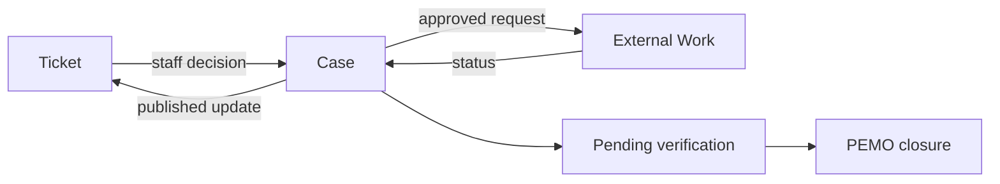

# External Work and Case Lifecycle

- **Locked:** Ticket is the resident communication record and remains; it may create/link to a Case.
- **Locked:** Case is internal handling, not maintenance. External FM/IWMS/CMMS/EAM owns physical work and assets.
- **Locked:** external completion never automatically closes a Case.
- **Proposed:** neutral External Work Management Interface stores reference, translated status, sync state, last sync and approved link.
- **Unresolved:** first target, statuses, auth and webhook contract.

## Transition and outcome table

| Path | Authority and transition | Idempotency / correlation / causation | Audit effect | Resident-visible effect | Case state |
|---|---|---|---|---|---|
| Normal | Help Desk creates/links Case; Service Case authorizes external request; external system accepts | Ticket/Case/work-request IDs; shared correlation; causation from originating command/event | Ticket link, Case creation and external reference recorded | Staff deliberately publishes a factual update; no work success implied before acceptance | Open → External Work Requested / In Progress |
| Failure | Integration Hub records rejected/failed request; Service Case decides next action | Same business request key; failure event causation retained; no blind duplicate | Failure, response and exception recorded | Explain pending/failure only when staff publishes; never show queued as completed | Remains Open or External Work Failed |
| Retry | Integration Hub retries according to bounded policy; Service Case remains authority for re-request | Same correlation; each attempt has unique message ID and attempt number; deduplicate business request | Attempt, delay and result audited | No duplicate resident message unless staff chooses an update | External Work Requested / Retry Pending |
| Duplicate | Integration Hub detects duplicate message/request and returns prior outcome without reapplying | Idempotency key and source message ID checked before side effect | Duplicate detection recorded or linked to original | No duplicate Ticket/Case/work representation | Unchanged |
| Cancellation | Authorized staff or external owner requests cancellation; Integration Hub records outcome; physical cancellation belongs externally | Cancellation command has own message ID and causation; original correlation retained | Authority, reason and external result audited | Staff may publish cancellation/pending status | Open, Cancellation Pending or Cancelled |
| Rejection | External system or policy rejects work; Service Case reviews and may correct/resubmit | Rejection linked to original request and correlation; resubmission gets a new attempt ID | Reason, mapping and decision audited | Staff publishes a clear rejected/pending update if appropriate | Open or External Work Rejected |
| Timeout | Integration Hub marks no-response timeout; it does not infer acceptance or completion | Timeout event causates from request; retries only within policy | Timeout, last attempt and exception audited | Resident sees pending only through deliberate staff communication | Timeout / Awaiting Review |
| Out-of-order update | Integration Hub applies only contract-approved sequence/version/time rules; stale update quarantined | Source event ID, sequence/version and correlation retained | Applied/quarantined decision audited | No resident update from a rejected stale state | Prior valid state retained |
| Completion | External system reports completion; Service Case records proposed resolution and performs PEMO verification | Completion is idempotent and linked to external reference/correlation | Completion and verification evidence audited | Staff may publish completion subject to verification | Pending Verification; never auto-closed |

One Ticket has zero or one primary Case; one Case may relate to many Tickets and external references. Residents see their own Ticket, not internal notes or other residents. PEMO does not store technician, parts, inventory, preventive-maintenance, costing, procurement or asset-lifecycle records. Only an authorized PEMO verification action may close the Case.