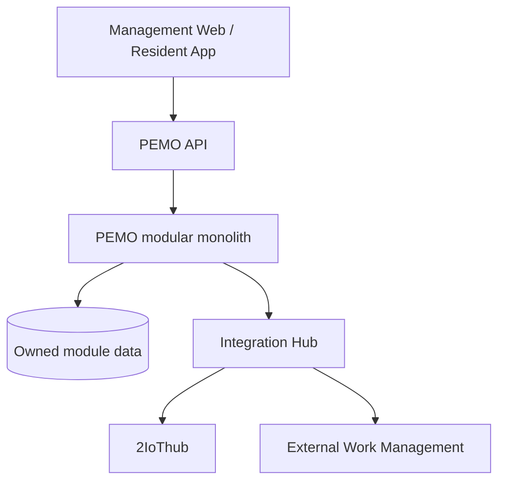

# Logical Architecture

- **Locked:** PEMO/2IoThub/external-work ownership boundaries and resident-facing product doctrine.
- **Proposed:** modular monolith, contract-first interfaces, event-driven integration and monorepo direction.
- **Proposed:** PEMO API, bounded modules, PostgreSQL, object storage, audit and Integration Hub as logical capabilities.
- **Unresolved:** framework, cloud, broker/outbox, storage and observability.

Modules do not write another module's tables. Commands, queries, stable IDs and versioned events cross boundaries. The Integration Hub translates protocols, authenticates, maps, retries, deduplicates and records exceptions; it does not decide Ticket, Case, safety or audience outcomes. The proposed architecture direction remains subject to explicit decision records; no framework, broker, cloud or vendor is selected here.