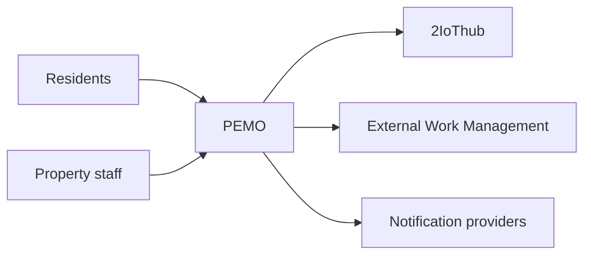

# Overview and System Boundaries

- **Locked:** PEMO is resident/customer-facing workflow and communication software.
- **Locked:** PEMO is not a BMS, FM, IWMS, CMMS, EAM, asset-management, statutory fire-alarm or emergency-response system.
- **Proposed:** modular monolith, contract-first interfaces, event-driven integration and monorepo.
- **Unresolved:** framework, deployment topology, broker/outbox and vendors.

PEMO owns resident workflows, communication history, management coordination and auditable response. 2IoThub owns devices, raw telemetry, gateways, OT/IT protocols and alarm lifecycle. External FM/IWMS/CMMS/EAM systems own physical work and asset lifecycle.

PEMO supports resident safety communication and response; it does not replace certified alarms or emergency services. No raw telemetry, device control, alarm acknowledgement/suppression/clearance, physical maintenance, technician dispatch or emergency dispatch belongs in PEMO.