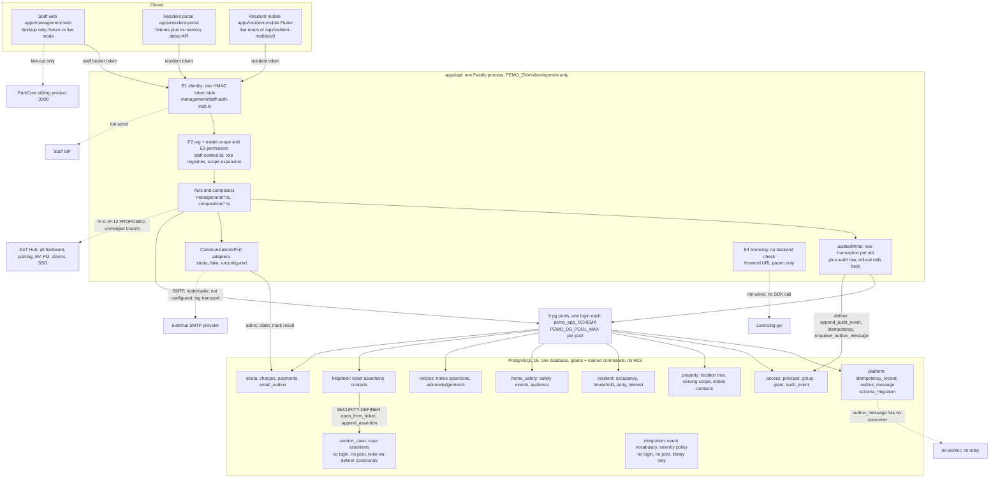

# PEMO-grok: handover to Codex (incoming architect)

| | |
|---|---|
| Version | v1.3 |
| Date | Fri 20 Nov 2026 (AEDT, Australia/Sydney, UTC+11); PEMO-grok state observed 22:30-23:10 AEDT, PEMO-next and listeners re-observed 23:35-00:05 AEDT |
| Author | Grok Bot (executor), on behalf of PT Lui. Requests: PT messages t611u (v1.0) pt614u (v1.1), pt615u (v1.2) and pt616u (v1.3) |
| Reader | Codex, incoming PEMO architect |
| Reviewed product baseline | `75b08fa4efc247a50ba553969d66f68c22390e69` |
| Document base | `834af37` (current `main`), branch `docs/codex-handover` |
| Method | Existing R&T evidence plus read-only inspection of code. Nothing was deployed, migrated or restarted, and no shared service or database was touched. v1.0 stayed local; v1.1 is the first pushed version (docs-only PR, left open). v1.2 adds one end-to-end run of the section 6.3 runbook on a disposable clone and a private Unix-socket PostgreSQL cluster (section 6.4.1); that run touched no existing system. |

**Changelog:** v1.0 (20 Nov 2026 AEDT) first issue, local commit `32bcd2f`. v1.1 (20 Nov 2026 AEDT) applies PT's follow-up (pt614u): section 7.4 now records the 12 architect decisions from `Grok-Codex-handover-decisions.md`, each split into approved product rule / implemented today in PEMO-grok / implemented today in PEMO-next; section 1.4 is rewritten from the current PEMO-next checkout (booking, gateway, visitors; implementation, isolated test evidence and live verification kept apart); U2 closed and U11 restated as an agreed rule with a pending provider contract (section 8); section 6.3 startup uses a fresh `mktemp -d` run directory and checks listener ownership and port reservations before starting anything; section 1.3 live-port attribution corrected (v1.0 named the wrong checkout, and mislabelled `:5177` as ParkCore); the "no browser test hit a live API" finding is scoped to the reviewed Grok build. v1.2 (20 Nov 2026 AEDT) applies PT's runbook follow-up (pt615u): the section 6.3 script now records the API and UI child pids and verifies, before any login, that each owns its listener and runs from the clone (abort on mismatch; cleanup stops only verified pids of this run); ports are chosen after checking listeners, systemd sockets and unit files, containers and project reservations (Smart Toilet 5173-5177 preserved) with strict binding; private PostgreSQL identity is checked with `current_database()`, `current_setting('port')` and `current_setting('unix_socket_directories')` (`inet_server_port()` is NULL over a Unix socket). The script was run end to end, with three failure injections (6.4.1). Tag targets confirmed (7.4 decision 7); `88a72e6` recorded as the combined six-area review baseline; the coordinator creates the tags. U19 closed; U24-U25 added. v1.3 (21 Nov 2026 AEDT, pt616u): the runbook's port picker also excludes configured host-port bindings of every container, running or stopped (an installed but unreadable container runtime aborts the run); ports `5173`-`5177` are recorded as reserved exclusively for Smart Toilet, even when its services are stopped; focused check in 6.4.2.

**How to read this.** Links are relative to this file (`../../` is the repo root). `UNVERIFIED` means no report or command of mine backs the statement; the note beside it says what would verify it. Report names (`E-…`) are listed in section 6.6 and live outside the repo. Status labels in the coverage matrix are the five PT specified; "end-to-end tested" here means real HTTP route, module, real Postgres, exercised by the integration suite. **For the reviewed Grok build (`75b08fa` / `88a72e6`) no browser test hit a live API:** its Playwright suite ran in fixture mode (E-6A section 7), so no PEMO-grok UI row is end-to-end in the browser sense. That is a finding about that build and its evidence only. It says nothing about PEMO-next, whose own browser runs are described separately in section 1.4.

## 0. Summary

- PEMO-grok is a Node 22 / TypeScript / Fastify **modular monolith** on PostgreSQL 16 for estate management (properties, residents, notices, finance reads, help desk, home safety), with a React staff web app, a React resident portal and a Flutter resident app. It is dev-grade: the app refuses to start unless `PEMO_ENV=development`.
- `75b08fa` passed independent R&T at code level. **Dev merge: ready (done, PR #20 squash-merged as `834af37`). Production release: not ready.** SMTP provider, staff IdP, licensing and every hardware / 2IoT / parking / FM integration are unconfigured and untested (E-6A section 5).
- The processes listening on the live ports (:3200, :5185, :5186) have working directories in **other worktrees** (`copa-wave0-backend`, `style-4s-facelift`), not in the accepted candidate's tree. Which build each process actually loaded is UNVERIFIED (section 1.3).
- The architect decisions of 20 Nov 2026 (section 7.4) make **PEMO-next (Go) the target for new product work**; PEMO-grok is the reviewed reference for workflows, contracts and tests. PEMO-next already implements far more than its first status snapshot says (section 1.4), but most of that work is **uncommitted** in its checkout and its test and live evidence is its own record, not re-run here.
- The largest surprises for a new architect: the case acts and the party / interest / household-membership tables have **no HTTP route or runtime reader** in the candidate; Visitor Management, ticket assign / status, invoices-demo and QR pass are **in-memory demo**; there is **no backend licensing**; history is **squashed** so the reviewed SHAs are not ancestors of `main` (section 1.2).
- Section 7 lists three constraints to keep, three design gaps, the actions by owner, and the recorded architect decisions (7.4) with the first R&T priority for the Go product (7.5).

## 1. Candidate and project identity

### 1.1 What is what

| Item | Value | How I know |
|---|---|---|
| Repository | `git@github.com:rbszwmr-aus/PEMO-grok.git` (origin) | `git remote get-url origin`, read-only |
| Main checkout | `~/code/PEMO-grok` on the AMD host (`amd128`), on `feat/qr-pass-v0-visitor` @ `283e595`, 2 untracked entries (`.runlogs/`, `docs/design-ref/`), no stash. At 23:35 AEDT none of the listeners checked had this directory as its working directory (section 1.3); v1.0 said it served the live ports, which was wrong. Do not switch or clean it: it is somebody's working checkout. | `git status`, `git worktree list`, `ss -ltnp` + `/proc/<pid>/cwd` |
| `main` / `origin/main` | `834af37b31e0…` (identical, observed 22:35 AEDT). Subject: "PEMO-grok final candidate: F6 + D1 + R9 + body-parse fix (product 75b08fa) (#20)". Parent `fb76c63`. | `git rev-parse` |
| Tested SHA | `75b08fa4efc2…` (product). Parent `6423e6e`. | E-FIN section 2 |
| PT's last verified branch | `review/final-candidate` @ `37e43a89d984…` = `75b08fa` + one docs file ([`final-candidate_v1.2.md`](final-candidate_v1.2.md)) | `git diff --stat 75b08fa 37e43a8` |
| Later changes since 75b08fa | **None in code.** `git diff --stat 75b08fa 834af37` = 1 file, `docs/reviews/final-candidate_v1.2.md`, +233. The tree of `main` equals the tree of `37e43a8` (`git diff main 37e43a8` is empty). | git, read-only |
| Working tree for this document | `~/code/PEMO-grok-wt/codex-handover`, branch `docs/codex-handover`, from `834af37`. v1.1 is pushed once (no force) and opened as a docs-only PR for review; not merged. | `git worktree list`, PR |
| Local-only work needed to reproduce | **None.** `main` contains everything. Old local worktrees (e.g. `~/code/PEMO-grok-wt/final-candidate` @ `37e43a8`) are evidence copies, not requirements. | section 1.2 |
| PR | [#20](https://github.com/rbszwmr-aus/PEMO-grok/pull/20), target `main`, **merged by squash** (`834af37`). `refs/pull/20/head` on origin = `37e43a8`. | `git ls-remote origin`; merge per PT's instruction |
| PR checks | GitHub `register` check fails on the **pre-existing PID-tag policy** (276 untagged commits in the history). It is not a product defect. The **AMD gate comment on PR #20 was the merge evidence.** | PT's note; the comment text itself I did not re-read: UNVERIFIED (open the PR to verify) |
| Previous `main` | `fe0decd` (2026-09-08), kept on origin as `backup/main-fe0decd`. It is not an ancestor of `main`. Its one commit that `main`'s history lacked **by SHA** ("fix(management-web): accept Backend helpdesk chrome wire on live reads") has an equivalent in `main`'s history: `8302980` (2026-09-25, same subject), an ancestor of `main`. No cherry-pick needed; U2 is closed (section 8). Merge-base of `fe0decd` with `main` is `ff91f20`. | git |

### 1.2 History caveat (read before using `git log`)

`main` is one squash commit on `fb76c63`. **`75b08fa`, `37e43a8` and `fe0decd` are not ancestors of `main`**, so `git log main` does not show the reviewed commits. They remain reachable through `refs/pull/20/head` (`37e43a8`) and the local branches. Do not delete `review/final-candidate`, `fix/*` or `perf/*` locally until an archive tag or bundle exists (not created by me; decision 7 in section 7.4 recommends immutable annotated review tags). The one `fe0decd`-only commit does not need rescuing: its change is in `main` as `8302980` (evidence in section 8, U2, closed in v1.1).

### 1.3 Live ports: who owns them, and which build they run

Two different facts, kept apart on purpose:

- **Listener attribution** = which process holds the port and which directory it was started from. Observed read-only at 23:35 AEDT with `ss -ltnp` and `/proc/<pid>/cwd` (same user only; no process was signalled, no port was probed).
- **Running build identity** = which commit and `dist` the process actually loaded. A working directory and its branch tip do **not** prove this (the branch may have moved or `dist` may be older than `HEAD` since the process started). **UNVERIFIED for every row below.** It would be verified by the owner comparing process start time with the commit and `dist` times, or by the owner's own `/health`; I did not probe any shared port.

| Port | Listener attribution (23:35 AEDT) | Reserved by / note |
|---|---|---|
| `:3200` | `node` with cwd `~/code/PEMO-grok-wt/copa-wave0-backend/apps/api`; that worktree's branch is `feat/copa-wave0-backend` @ `c3c925c` | PT rule: do not touch. Historical default API port. Whether it is the in-memory demo API or the Postgres API is UNVERIFIED (`scripts/amd128-up.sh` describes the demo API, but that this process was started by it is not shown). |
| `:5185`, `:5186` | `node`/Vite with cwd under the `.worktrees/style-4s-facelift` worktree; branch `feat/style-4s-facelift` @ `d65ee85` | PT rule: do not touch. The older locked pair `5175` / `5176` is in the next row. |
| `:5175`, `:5176` | `node` with cwds in SmartToilet worktrees (`comparison-20261107/candidate`, `cstms-codex-integrated-1107`) | The old PEMO-grok Vite pair is **now held by SmartToilet** (range `5173`-`5177` is reserved **exclusively for Smart Toilet**, even when its services are stopped and nothing listens). Never assume a historical port is free or ours. |
| `:5177` | SmartToilet project (`cstms`, release `bea956d`) | **Not ParkCore.** v1.0 and the old diagram said ParkCore UI `:5177`; that was wrong. Treat as another project's port. |
| `:3300` | `sited` (ParkCore) | Another product; link-out target only. |
| `:3210` | `pemo-api` in the PEMO-next tree | Reserved to PEMO-next (its `AGENTS.md`: only the user unit `pemo-next.service` launches it). |
| `:18121` | `pemo-management-dev`, bound to the Tailscale address `100.78.32.79` only | Reserved to PEMO-next review (its `AGENTS.md`; "recheck before every start"). `:18120` is its standalone UI reference port. |
| `:5432` | listener present on `127.0.0.1`; owner **not visible** to my user | Shared PostgreSQL. PT rule: never touch. |

None of the listeners had `~/code/PEMO-grok` as its working directory, so the `283e595` checkout is not what serves these ports. v1.0 said it was (an error, now fixed). The live ports therefore do not serve the accepted candidate (`834af37`), and anyone testing on `:5185` is testing whatever those worktrees built, not the reviewed code. Decision 6 (section 7.4) says to leave them in place and test the candidate on its own ports.

**Reservations.** I found no central registry in this repo. The set used by the runbook (section 6.3) is: `3100` HMS; `3200`, `5185`, `5186` PEMO-grok live; `3210`, `18120`, `18121` PEMO-next (its `AGENTS.md`); `3300` ParkCore; `5173`-`5177` **exclusively Smart Toilet**, reserved even when its services are stopped (v1.2 listed this range as shared with CC PEMO and `5174` as HMS; both corrected by PT on 21 Nov 2026); `5179` ParkCore console; `5432` shared PostgreSQL; `55434` PEMO-next PostgreSQL. The first four groups come from PT's rules and PEMO-next `AGENTS.md`; the rest were supplied by PT on 20 Nov 2026 (23:49 AEDT). Per-lane port assignments from the coordinator are **not recorded anywhere I could read**: U18. The runbook also treats every live listener, systemd socket unit, number found in a unit file and configured host-port binding of any container, running or stopped, as taken. Historical defaults in this note (API 3200, Vite 5175/5176, private PG 5499, private API 3297) are examples only.

### 1.4 Relationship with `/home/luipt/projects/PEMO-next`

Observed read-only at 23:35-00:05 AEDT on 20 Nov 2026: `git --no-optional-locks`, source and docs read, test files listed and counted. `.env` not opened. **No test, build, migration or request was run against anything.** Reasons the tests were not run: PEMO-next's own integration tests use the shared Postgres test database `pemo_next_test` and its `AGENTS.md` forbids Go database tests while a review is in progress, so they are marked "not run" below.

**Read this first: the checkout is far ahead of its git history.** The last commit is `5d24e2c` (2026-11-14). Beyond it the working tree holds **114 uncommitted entries (37 modified, 77 untracked)**, including all of Visitor V1 (`internal/app/visitors.go`, `internal/migrate/sql/038_visitors.sql`, staff and resident visitor UIs, `contracts/PEMO-Visitor-V1-API.md`) and the 2IoT Hub / ParkCore gateway contract drafts. `git log` therefore does not reproduce what its docs say is deployed. Ask for a commit or tag of the reviewed state before relying on it.

**Evidence levels used below** (kept separate on purpose):

| Level | Meaning here |
|---|---|
| Implemented | Source is present in the checkout (path given). Not a claim that it passed review. |
| Isolated test evidence | Tests are present in the checkout, **and/or** PEMO-next's own notes record a passing run against its private test database or review slot. Those results are PEMO-next's record (architect / its R&T). **I did not re-run any of them.** |
| Live verified | Observed working on a deployed service, with a real counterpart where one is involved (hardware, Hub, provider). |

**Identity facts**

| Question | Finding |
|---|---|
| Stack | Independent **Go 1.27** backend (pgx) plus React staff portal (`web/management`), a separate resident web portal (`web/resident`) and a Flutter resident app (`mobile/resident`). Own PostgreSQL (loopback `:55434`), database `pemo_next` (plus `pemo_next_dev` and `pemo_next_test`). 38 numbered migrations (`internal/migrate/sql/001..038`), 125 Go files in `internal/app`, 71 of them tests; 193 top-level `Test` functions under `internal/*`. |
| Source of truth | Its own `docs/migration/status.md` (270 lines, updated 2026-11-19), `docs/migration/feature-parity.md` and the per-order implementation notes. **v1.0 of this note quoted the original README ("only the property/unit directory is live") and understated PEMO-next badly.** The current register lists Orders 1-5, resident app milestones M1-M4 and Visitor V1 as accepted by its architect and R&T. |
| Releases per its docs | `main` service on `:3210`: `f4e6270` / schema 36 (accepted 14 Nov). Visitors development service on `:18121`: `visitors-dev-20261119-r1` / schema 38. Of this I verified only that listeners exist on both ports (section 1.3); release identity is UNVERIFIED. |
| What it shares with PEMO-grok | **Data only, as a one-way copy:** a read-only `pemo_grok` snapshot (3 estates, 1,092 units, 5 people, 766 households, 5 memberships, 7 occupancy assertions) imported into a PEMO-next test database. A test fixture, "not a cutover or synchronization". Decision 1: a customer migration needs its own mapping, reconciliation and cutover decision; none exists. |
| Shared code, packages, DB, pools | **None found.** Different language, different cluster port, different roles. |
| Shared contracts | None shared as files. PEMO-next's `contracts/gateway/` carries COPA / 2IoT Hub drafts that follow the same boundary as PEMO-grok's C3 (the Hub owns vendor protocols, PEMO owns estate identities, configuration and bookings). Whether it matches PEMO-grok's IF-0..IF-12 drafts is U10. |

**Capabilities that this handover was asked to re-describe**

| Area | Implemented in code (checkout) | Isolated test evidence | Live verified |
|---|---|---|---|
| **Booking** (Order 3, resident M3) | Staff facility booking lifecycle and history with capacity and eligibility checks, facility picker, Year/Month and Day/Week calendar (`internal/app/booking_calendar.go`, `business_booking.go`, `booking_pos.go`, migrations `023_booking_pos`, `029_booking_physical_location`); HKD fee revisions, separately authorised cash / manual payments and refunds, immutable receipts; resident self-booking and cancellation with server eligibility, capacity and assessed fees (`resident_booking.go`, migration `034_resident_booking`, `web/resident/src/BookingView.tsx`, Flutter `booking_view.dart`, which is **modified, uncommitted**); staff UI `BookingPage`, `BookingCalendar`, `BookingPOS`. **Not implemented:** live payment processor, GL / tax ledger, opening-hours / rate engine, physical check-in, automatic fee / refund / access from a cancellation, booking-based access provisioning (the access notes say "no booking provisioning"). | Present: `booking_pos_test.go` (4 tests), `resident_booking_test.go` (4), `booking_calendar_review_test.go` (1), browser script `tests/browser/order3-booking-pos.mjs`. Recorded by its notes: schema-24 full race run passed; Booking/POS browser run 11 outcomes with zero page/console errors; 370-day calendar summary about 1.70 s over 1,006 bookings; resident M3 accepted by its R&T. **Not re-run by me.** | Its notes record Order 3 deployed to `:3210` as `7ab3eda` / schema 24 (readiness, protected-401, API identity and binary hashes matched), later `cbaf5ca` / schema 35 for resident M3. I did **not** probe `:3210`; I saw only a `pemo-api` listener. No live payment provider, so no live payment verification exists. |
| **Gateway integration** (inbound contract v1.0, Orders 2, 4, 5) | Estate-scoped service tokens bound to one organisation, estate and source (`POST /api/v1/gateway/tokens`, only a SHA-256 digest kept, revoke endpoint); paged core feeds (`GET /api/gateway/v1/core` with `view=people` or `view=locations`); durable event inbox keyed by estate / source / message id (`POST /api/gateway/v1/events`); staff management reads; source-scoped clubhouse / kiosk, access and parking / EV feeds with revision-aware reconciliation (`internal/gateway/`, `internal/app/business_gateway.go`, `resident_access.go`, migrations `022`, `025`, `026`, `028_gateway_contract_guard`, `036`, `037`). **Outbound adapters are unconfigured:** the status view returns `outboundConfigured:false`, `commandStatus:"unconfigured"`; no hardware command is issued or reported as successful. The COPA / 2IoT Hub channel contract v0.1, Hub management contract v0.2, ParkCore review comments v0.1 / v0.2 and JSON schemas are **drafts, untracked**, and its README says "interface preparation only; no new endpoint, source or outbound sync is configured". | Present: `internal/gateway/{contract,registry_sync,resident_access}_test.go`, `internal/app/gateway_contract_guard_test.go`, `access_read_test.go`, `resident_access_test.go`; browser scripts `order2-clubhouse`, `order4-access`, `order5-mobility`; synthetic examples in `contracts/gateway/examples`. Recorded by its notes: Order 5 full race run 441 s plus browser runs, all against its test database with synthetic feeds. **Not re-run by me.** | **None.** No Hub, ParkCore, vendor system or device was connected: its register says gateway onboarding, vendor protocols and outbound hardware commands "remain unconfigured" and "no hardware-success claim is added". Observed status is not an access grant. |
| **Visitors** (Visitor V1) | Staff and resident-web invitations; explicit staff approval; local private QR issuance and replacement; authenticated single-use reception check-in / out; cancellation and expiry; bounded immutable history; staff current-page CSV; host policy from current occupancy; estate / module permission checks (`internal/app/visitors.go` 218 lines, `internal/modules/visitors.go`, migration `038_visitors` with row-level security, `web/management/src/Visitors.tsx`, `web/resident/src/VisitorView.tsx`, `contracts/PEMO-Visitor-V1-API.md`). **All of these files are untracked.** Feature code `pemo.visit.checkin` appears in the contract as proposed, issuer registration is separate. **Not implemented:** native Flutter Visitor, hardware / Hub provisioning, paid delivery, production guest-data retention or deletion. | Present: `visitors_test.go` (2 tests), `visitors_review_test.go` (4). Recorded by its notes: qualified targeted Go race logs (`.run/visitors-integration-final.log`, corrected independent re-test `.run/visitors-review-retest.log`, 4.696 s), 14 staff and 5 portal frontend test files, both TypeScript / Vite builds, vet, and a final desktop and mobile browser run (7.1 s, artifacts under `/home/luipt/browser-ui-results/pemo/2026-11-18T21-19-11-793Z-d4e3ec/`). Its own wording is "qualified targeted", not a monolithic full suite. **Not re-run by me.** | Only as an isolated **development** release: `visitors-dev-20261119-r1` / schema 38 on the Tailscale-only review service `:18121` per its docs; `main` `:3210` stays at schema 36, so Visitors are **not** on the main service. I saw a `pemo-management-dev` listener on `:18121`; release identity UNVERIFIED. No hardware or Hub was involved. |

**Other areas, same three-way reading** (details in its `feature-parity.md`; none re-run by me):

| Area | Implemented (per code and its register) | Test evidence | Live |
|---|---|---|---|
| Properties, households, ownership, tenancy, occupancy | Location lifecycle; verified legal ownership and company mandates; tenant company identities; household placement; **separate** membership, occupancy and tenancy with scheduled cancellation, history and transactional occupancy events; scoped CSV / XLSX import and export. No ownership or occupancy is inferred. | Its Order 1 and property-management-core notes record targeted runs on a private copy; the Go suite is its own record. | On `:3210` per its docs (schema 36). Exact behaviours not probed. |
| Licensing | Licensing v1.1 consumption with online source, signature / cache / refresh, UI and API enforcement, explicit development fixtures (`internal/licensing`). Offline source returns typed "not configured". | `internal/licensing/*_test.go` present. | **No live licences, caller credentials or module codes issued** (its `AGENTS.md`). |
| Access, parking / EV, clubhouse, Home Safety | Configuration, directories, history and observation views behind the gateway feeds above. Local state is not physical access. | Tests and browser scripts present (Orders 2, 4, 5, Home Safety). | None on hardware. |
| Resident apps | Separate resident principal, web portal and Flutter app: inbox, notices, documents, booking, access references (M1-M4). | Its notes record Flutter and Go tests and an Android ARM64 debug build. | Per its docs only; not probed. |
| Help desk / cases, finance ledger | Its register lists "Requests / help desk / cases" and finance as **not implemented**; I found no case or help-desk file in `internal/app` (file-name match only, not an exhaustive search). Booking fees are not a ledger. | n/a | n/a |

Rule of thumb: nothing PEMO-next does changes PEMO-grok, and nothing here may edit it. Its notes say "accepted" for most rows; that is PEMO-next's architect and R&T, **not** the incoming architect's acceptance. First R&T priority for the Go product: section 7.5.


### 1.5 Branches not in `main` (work that exists but is not accepted)

Counts are commits ahead of `main` (`git rev-list --count main..<branch>`, which includes pre-squash history for the `fix/*`, `perf/*` and `review/*` lines, so only the small feature branches are real unmerged work): `feat/qr-pass-v0-visitor` +1 (live checkout), `feat/qr-pass-v0-surfaces` +7, `feat/front-counter-visitors` +11, `feat/copa-wave0-backend` +32, `feat/s04-audit-log-live` +1, `feat/s05-integration-status` +5, `feat/s06-notifications` +2, `feat/s07-documents` +2, `feat/surfaces-small-fixes` +2, `feat/ux-v3-declutter` +22, `feat/style-4s-facelift` +111, `feat/dashboard-charts` +101, `docs/2iot-hub-interfaces` +9. None was reviewed in this baseline. Treat them as inputs, not as product.

## 2. Architecture and core domain

### 2.1 The one diagram

Solid lines are wired and tested. Dashed lines are **not wired** in this candidate (contract, stub or nothing behind them). Codes `E1`-`E4` mark where identity, org / estate scope, permission and licensing are decided; the table after the diagram says which layer enforces each.



### 2.2 Which layer enforces what

| Rule | DB-enforced | Application check | Developer convention only |
|---|---|---|---|
| Module A cannot read or write module B's tables | **Yes:** per-module logins, `pemo_priv_*` roles, `SELECT`+`INSERT` only, legacy `pemo_app` has no table rights, `SET ROLE` to a peer denied (10-login matrix, E-F6, E-6A 4.5). [`database/roles/000-roles.sql`](../../database/roles/000-roles.sql), [`010-grants.sql`](../../database/roles/010-grants.sql) | | |
| Cross-module code imports | | CI gate `pnpm --filter @pemo/api run check:dependencies` (dependency-cruiser, 363 modules; 11 injected violations all refused, E-6A 4.4) | pnpm `exports` map per module (one public entry) |
| Writes to `service_case`, audit, idempotency, outbox | **Yes:** only six named `SECURITY DEFINER` commands: `access.append_audit_event` (0146), `platform.lookup_idempotency` and `record_idempotency` (0147), `service_case.open_from_ticket` and `append_assertion` (0148), `platform.enqueue_outbox_message` (0149) | Acts call them inside `auditedWrite` | |
| Case belongs to the ticket's organisation | **Yes:** migration [0150](../../database/migrations/0150_service_case_org_constraint.up.sql) (wrong org refused with 23514; missing ticket P0002) | Act refuses first (`no-such-ticket`) | |
| Act and audit row commit together | Single connection, single transaction | [`auditedWrite`](../../modules/platform/src/audit/audited-write.ts) owns the transaction and **refuses nesting**; refusals returned as values roll back and write **zero** audit rows | |
| Append-only history, current = `MAX(version)` (ADR-013) | `SELECT`+`INSERT` grants only; six-column `UPDATE` on `strata.email_outbox` for the Strata role only | Readers resolve `MAX(version)`; liveness computed from effective dates, never a flag | |
| One send per (notice, recipient, generation) | **Yes:** unique `send_key` (0145) | Atomic claim `pending` to `sending`; unknown outcome not re-sent | |
| E1 who is calling | | Dev HMAC stub only; unknown / expired / forged token refused (15 cases, E-6A 4.5) | Resident vs staff token prefixes differ |
| E2 org and estate scope (which locations) | **No RLS anywhere.** Only 0150 constrains org in the DB | Every query carries `organizationId`; grants are on location nodes, expanded to a membership Set per request (the `scopeExpansion` port from Property, used by `staff-context.ts`; 27,104 oracle decisions, 0 mismatches, E-6A 4.1) | |
| E3 permission to act (role, ticket / case / notice state) | | Registries (`caseActRegistry`, notice `permittedActions`), `hasEstateStaffGrant`, `estateStaffCovering` | |
| E4 module licence (menu, URL, API, export, jobs) | **Nothing** | **Nothing in the backend.** Menu / URL hide by `?modules=` in the browser | Doctrine only: [`docs/contracts/platform-module-entitlements.md`](../../docs/contracts/platform-module-entitlements.md) |
| Forbidden terms in resident text, party / interest vocabulary | | Tests: `case-forbidden-terms`, `interest-denylist`, `resident-text-pairing` | |
| Reason codes, ADR numbering, PID tags | | Tests / `governance.yml` | Process; the `register` check is red on history (section 1.1) |

Resource bounds that are application-level: request body 1 MiB (413), page limit clamp 2,000, statement timeout (default 5,000 ms), pool wait (default 2,000 ms). Pool arithmetic is in section 6.5.

### 2.3 Domain model in one page

Chain: **organisation → estate → location tree** (ADR-003) → **unit**. People are `resident` rows. Four different facts about a person and a unit are kept apart on purpose (ADR-011 D7):

| Fact | Table / module | Meaning | Written by code today? |
|---|---|---|---|
| Interest (ownership, tenancy) | `resident.party`, `resident.interest` | Who holds a legal interest in a unit | **No.** Seeds only (`database/seeds/50-party-and-interest-demonstration.sql`); no route and no reader found in `apps/api/src` or `modules/*/src`. The D7 proof tests are in the approved failing ten. |
| Occupancy (who lives there, effective-dated) | `resident.occupancy` assertions (roles `owner_occupier`, `tenant`, `household_member`, `caregiver`) | Drives home authorisation, notice audience, safety audience | **Yes:** `POST /units/:unitId/occupancies`, `POST /occupancies/:id/end` ([`occupancy-commands.ts`](../../modules/resident/src/occupancy/occupancy-commands.ts)) |
| Household | `resident.household`; `household_membership` | Grouping and contacts | Household contacts read ([`household-contacts.ts`](../../modules/resident/src/household/household-contacts.ts)); **no reader or writer of `household_membership`** found. An occupancy carries a `household_id`. |
| Staff access (who may act on which nodes) | `access` grants and group membership | Not residents | Yes: `POST /grants`, `/grants/:id/revoke`, `/principals`, `/groups/:id/members`, `/memberships/:id/remove` |

**Worked example.** Flat 12A in Block A. Ms Owner owns it and lives in another estate. Mr Tenant rents it and lives there. His daughter lives with him and has her own door card.

| Person | Interest | Occupancy | Household | Physical access entitlement | What the candidate can do |
|---|---|---|---|---|---|
| Ms Owner | ownership of 12A | **none** | none | none | Representable in the schema and seed. **Nothing reads it:** she is in no notice or safety audience (the audience resolver reads occupancy only, [`occupancy-audience.ts`](../../modules/resident/src/occupancy/occupancy-audience.ts)) and has no resident-app access to the flat. ADR-011 D8 owner projection is not implemented (no `interest` reader). |
| Mr Tenant | tenancy of 12A (seed only) | `tenant`, live | his household | none in PEMO-grok | Authorised as home of 12A (`authorizeUnit`), receives notices and safety events, can report tickets. |
| Daughter | none | `household_member` with the same `household_id` | same | **not modelled** | Authorised exactly as the tenant while her own occupancy is live; her end date is independent. A door card or gate pass is the access-control system's record; the PROPOSED IF-6 (`docs/contracts/2iot-hub/IF-6-access-credentials-occupancy-v0-PROPOSED_v0.2.md` on unmerged branch `docs/2iot-hub-interfaces`; not in `main`) would sync occupancy to the Hub and the Hub decides entitlements. |

**On tenant move-out** staff call `POST /occupancies/:id/end`:

| Stops | Remains | Cannot be represented today |
|---|---|---|
| The tenant's authorisation to the unit from `effective_to` (computed at operation time: `isActiveAt`, [`unit-authorization.ts`](../../modules/resident/src/authorization/unit-authorization.ts)). He disappears from audiences resolved **as at** later instants; the unit leaves his switcher (for a caregiver whose scope ended, the app says when it ended and that it can be renewed). | History: the original assertion, the appended `ended` assertion (append-only), notices he was addressed by (audience is resolved as-at publication), his tickets and cases, acknowledgements, sent-mail rows. The tenancy `interest` and household rows are untouched. | **No cascade:** the daughter's occupancy and the tenancy interest do not end automatically; each instance is ended by its own act. No act ends an `interest` (no write path). Door card, gate and parking entitlements are not in PEMO-grok, so "which physical access ends" is the access system's job. A lapse without an explicit end (`effective_to` in the past) is treated as ended by dating, not by an act (there is a seeded example, `occ_733_a12a1`). Partial joint tenancy, sublets and guest access: UNVERIFIED (no model found). |

**Naming.** The location class for a home is `unit` ("Unit / Flat / Room" in ADR-003; the sketch there shows all three words). The management UI renders a flat as block, floor, unit ("A · 12/F A1", [`flat-label.ts`](../../apps/management-web/src/data/flat-label.ts)), never a system id. Whether "room" (for example a care-home or student-hall room) is a distinct class: not defined; decision Q8.

**Shared areas, facilities, parking, gates.** ADR-003 location classes: `common_area`, `public_area`, `public_facility` (car park, garden, playground, EV charging bay), `clubhouse` (a container whose children are `public_facility` bookables), `building_service` (lift, escalator). Every non-unit location has a physical parent **and** a `serving_scope` (the population it serves), and the two are never defaulted from each other. A common-area safety event resolves to an audience through serving scope. PEMO holds the car park as a Location with an external reference; it does **not** own parking spaces, allocations, entitlements, tariffs, **gates**, plate recognition or transactions (ADR-003, "Car park"). Gates and parking spaces therefore have no table here. Booking a clubhouse sub-facility is the Amenities / Booking concern, not Property Core.

## 3. Functional coverage matrix

Status labels: **E2E** = end-to-end tested (real route / act, real Postgres) · **FIX** = tested with stub or fixture · **IF** = interface only (contract or UI, nothing behind it) · **PLAN** = planned · **OTHER** = owned by another system. Management API base is `/api/management-web/v0` (`M`), resident `/api/resident-mobile/v0` (`R`). All management routes are in [`apps/api/src/server.ts`](../../apps/api/src/server.ts); tests are in [`tests/integration`](../../tests/integration) and [`tests/contract`](../../tests/contract).

| # | Workflow | Actor | UI / API entry | Estate and permission rule | Status | Evidence |
|---|---|---|---|---|---|---|
| 1 | Properties: location tree and scope | Estate staff | UI S3Properties, scope rail. `GET M/scope`, `GET M/properties/tree` | Grants on nodes, expanded per request; revoked gives 0 rows; other estate gives 404 | **E2E** (API); UI **FIX** in Playwright | `p2-r4-tree-authorization`, `p2-r5-paging`, `scope-list-filtering`, `scope-differential-property`; E-6A 4.1 |
| 2 | Households and tenants: record or end an occupancy | Estate staff | `POST M/units/:unitId/occupancies`, `POST M/occupancies/:id/end`. UI Households / Residents are **fixtures**; list reads exist only as PROPOSED contracts ([`proposed-households-read-ops.md`](../../docs/contracts/proposed-households-read-ops.md), [`proposed-residents-read-ops.md`](../../docs/contracts/proposed-residents-read-ops.md)) | Unit must be inside the actor's scope; only a live instance can end; refusal writes nothing | **E2E** (API); UI **FIX** | `occupancy-scope-write`, `occupancy-end-write`, `occupancy-assertions`, `tenancy-negative` |
| 3 | Estate contacts | Estate staff | `POST M/estates/:estateId/contacts`. No UI call | Scope write | **E2E** (API only) | `estate-contact-scope-write` |
| 4 | Staff admin: principals, groups, grants, membership | Grant administrator | `POST M/principals`, `M/grants`, `M/grants/:id/revoke`, `M/groups/:id/members`, `M/memberships/:id/remove`. UI AdminUsers / Groups / Roles are **fixture / session-local**; there is no list route | ADR-010 / 012 delegation floors; audited | **E2E** (API); UI **FIX** | `grant-surface`, `membership-assertions`, `principal-identity`, `delegation-floors`, `audited-scope-write` |
| 5 | Resident web (portal): facilities, help desk, invoices, notices, visitor | Resident | `apps/resident-portal` screens Explore, FacilityDetail, helpdesk, invoices, notices, visitor | Demo token only | **FIX**: fixtures and the **in-memory** demo API (`apps/api/src/demo`, `packages/*-demo-store`); nothing in Postgres | `apps/resident-portal/test`; [`docs/contracts/resident-portal-v0-notices-visitors-demo.md`](../../docs/contracts/resident-portal-v0-notices-visitors-demo.md) |
| 6 | Resident mobile: home, services, account, safety, notices | Resident | `GET R/home`, `/services`, `/account`, `/safety/overview`, `/safety/events/:id`, `PUT .../acknowledgement`, `GET R/notices`, `POST R/notices/:id/{read,ack}`. Flutter [`apps/resident-mobile`](../../apps/resident-mobile) (inbox screen is a placeholder) | Resident token; `authorizeUnit` computed at operation time | API **E2E**; Flutter app **UNVERIFIED** (R&T read `live_repository.dart` statically and did not run Flutter) | `notice-routes-e2e`, `notice-acknowledgement`, `tests/contract/*`; E-FIN 5 |
| 7a | Notices: draft, approve, publish, schedule, withdraw, read, acknowledge | Estate staff, approver | `POST M/notices`, `POST M/notices/:id/:verb`, `GET M/notices[/:id[/acknowledgements]]`. UI S5Notices is **live** with `?source=live` | Notice targets must be addressable by the actor; approval rules (`requiresApproval`) | **E2E** | `notice-acts`, `notice-reads`, `notice-schedule`, `notice-publish-serialisation`, `notice-target-precheck`, `notices-origination` |
| 7b | Documents | Staff | UI Documents (fixture corpus). Backend branch `feat/s07-documents` unmerged | n/a | **IF** | none |
| 8 | Communication: email for notices, invoices, admin test | Estate staff | `POST M/notices/:id/email`, `/email/resend`, `GET M/notices/:id/delivery`, `POST M/strata/charges/:id/invoice-email`, `POST M/admin/email/test` | `hasEstateStaffGrant` plus coverage of every addressed node; denied calls create no outbox row | **E2E with fake / log transport.** Real SMTP **UNVERIFIED (BLOCKED)**. SMS, push, paid channels: no adapter found, **PLAN** | `batch-c-d1-communications`, `p1-f1-outbox-claim`, `p1-r2-send-authority`; `comms-variants.out` |
| 9 | Fees and invoices (read side) | Estate staff | `GET M/strata/charges[/:id]`, `GET M/strata/payments`; UI Charges, Payments **live** | Scope-filtered | **E2E** (reads). Creating charges, receipts, refunds, payment capture: no route (UI Refunds is a fixture) **IF** / **OTHER** (payment provider) | `strata-live-reads`, `p1-f3-delivery-coverage` |
| 10a | Help desk reads | Estate staff | `GET M/helpdesk/queue`, `/helpdesk/contacts/:id`; UI HelpDesk **live** | Scope | **E2E** | `p2-r4`, journeys |
| 10b | Help desk assign / status, resident-portal tickets | Staff, resident | `POST M/helpdesk/contacts/:id/assign`, `/status`, portal-ticket routes in [`demo/tickets-demo-routes.ts`](../../apps/api/src/demo/tickets-demo-routes.ts) | In-memory demo store, **not Postgres** | **FIX** (demo). **Do not mistake for the real case system** | `management-web-v0-tickets-helpdesk-demo.md` |
| 10c | Cases and tickets: open case from ticket, triage, notes, status, reopen, satisfaction | Staff, resident | **No route, no UI.** Acts exist in [`case-acts.ts`](../../apps/api/src/management/case-acts.ts) (`createCaseActs`) | `estate_staff` scope; ticket org = actor org; one primary case per ticket | **E2E at act level** (real DB, no HTTP). HTTP and UI **IF** | `case-acts`, `case-handling`, `cases-origination`, `case-channel-precheck`, `p1-r1`; E-6A 4.4 (`p35-final.out`) |
| 11 | Dashboard (S2 Overview) | Staff | `GET M/overview` exists and is tested; **no UI call**. UI S2Overview is a fixture. `feat/dashboard-charts` unmerged | Scope | API **E2E**; UI **FIX** | `gen064-overview-reads`, `estate-summary-basis` |
| 12 | Reports | Staff | UI Reports, report-export: fixture. No backend | n/a | **FIX** / **IF** | `apps/management-web/test` |
| 13 | Alarms and Home Safety | Resident; staff | Resident reads and acknowledgement as row 6. Staff `POST M/safety/events/:id/updates` (no UI call); UI S1HomeSafety is a fixture. **No ingestion route**: events are seed data | Audience from serving scope | Resident reads **E2E**; staff update **E2E** (API); ingest **IF** (IF-2 PROPOSED) / **OTHER** | `gen064-overview-reads`, `notice-acknowledgement`; `modules/home-safety` |
| 14 | Clubhouse / kiosk / front counter | Front-counter staff | UI VisitorFrontCounter + [`front-counter-client.ts`](../../apps/management-web/src/data/front-counter-client.ts): fixture default; with `?source=live` it calls `/front-counter`, which **no server route answers**. `feat/front-counter-visitors` unmerged. "kiosk" exists only as a ticket channel value | n/a | **IF** (one of the 14 known Playwright failures is `front-counter` live-source Bearer) | `pw-cand.json` |
| 15 | Facility booking and POS | Staff, resident | UI Bookings, calendar, check-in, rates, facilities (fixtures); resident portal Explore / FacilityDetail (fixtures). No backend, no POS | n/a | **FIX**. POS: **PLAN** (PEMO-next plan) | `apps/*/test`; ADR-003: booking is not Property Core |
| 16 | Access control (cards, doors, gates) | n/a | Nothing in schema or UI. IF-6 PROPOSED | n/a | **OTHER** (2IoT Hub / access system) | section 5 |
| 17 | Visitor management | Resident, front counter, guard | Demo: resident-portal `visitor`, `notices-visitors-demo-routes.ts`, QR pass v0 (`qr-pass-demo-routes.ts`, [`docs/contracts/qr-pass-service-v0.md`](../../docs/contracts/qr-pass-service-v0.md)), `VisitorRegister`, `VisitorLog` | Demo only | **FIX** (in-memory, `:3200`) | `packages/qr-pass-demo-store` tests |
| 18 | Patrol / virtual patrol | Guard, control room | None. Plan v0.4 (outside repo, section 6.4); IF-10..IF-12 PROPOSED | n/a | **PLAN** | none |
| 19 | Parking and EV | Resident, operator | Car park is only a `public_facility` location. UI ParkCoreLink is a link-out to the sibling product | n/a | **OTHER** (ParkCore, Hub) / **IF** | `pemo-parkcore-entitlements.md` |
| 20 | Facility management (work orders, assets) | FM | None. IF-4 PROPOSED | n/a | **OTHER** / **PLAN** | none |
| 21 | Digital twin | n/a | None in PEMO-grok. The COPA plan parks a 3D / BIM viewer and lets Smart-IoT / mBMS supply the twin | n/a | **OTHER** / **PLAN** | COPA build plan (outside repo) |

### 3.1 Flags

**Screens that show fixture data while the app is in live mode** (`?source=live` wires only the reads and sends listed in rows 1, 7a, 8, 9, 10a: [`live-config.ts`](../../apps/management-web/src/data/live-config.ts) says "Residents / visitors / households stay on fixtures"): S1HomeSafety, S2Overview, S4Cases, Residents, Households, Documents, Reports, Refunds, all Bookings screens, VisitorRegister / VisitorLog / VisitorFrontCounter, AdminUsers / Groups / Roles / Lists / Audit, IntegrationStatus. Whether each such screen carries a visible fixture label in live mode is UNVERIFIED for all except the ones R&T inspected (it states fixture and live screens "are labelled", E-6A section 5, item 4); inspect `?source=live` in a browser to verify.

**Backend workflows with no usable screen:** record / end occupancy (row 2), estate contacts (3), all staff admin writes (4), open case and all case acts (10c), `GET M/overview` (11), staff safety update (13), notice email resend and delivery detail beyond the notice screen, `POST /admin/email/test` beyond AdminEmail (UNVERIFIED which screen calls it).

**Capabilities that belong only to PEMO-next:** PEMO-next implements facility booking and POS, the inbound gateway and its clubhouse / access / parking / EV feeds, Licensing v1.1 consumption and Visitor V1 (section 1.4, with its evidence levels). Nothing in PEMO-grok depends on them.

**Undeclared in OpenAPI:** `POST M/notices/:id/email/resend` (route absent from the contract, E-D1 P3 2); the 400 `refused` and 413 `request-too-large` problem types (section 7.3).

## 4. Module design, licensing and extension

### 4.1 Module catalogue

Declared once in [`modules/platform/src/module-registry.ts`](../../modules/platform/src/module-registry.ts) (`ALL_SCHEMAS`); product-level ownership and prohibitions in [`docs/architecture/module-catalogue.md`](../../docs/architecture/module-catalogue.md). Every module's `package.json` depends only on `@pemo/platform` (checked: no module-to-module `@pemo/*` dependency). Dependency rules (apps/api/.dependency-cruiser.cjs): `no-module-to-module`, `no-deep-import`, `no-module-imports-app`, `no-simulator-in-runtime`, `no-circular`, `no-ui-imports-backend`, `no-ui-into-backend`, `no-mail-orchestration-imports-strata-storage`, `no-contract-writes`. Two baselined cycles are tolerated ([`.dependency-cruiser-known-violations.json`](../../apps/api/.dependency-cruiser-known-violations.json)): `management/notice-acts.ts` <-> `notice-permissions.ts`, and `BookingDialog.tsx` <-> `Bookings.tsx`.

Modules cooperate through **ports injected in** [`apps/api/src/wiring.ts`](../../apps/api/src/wiring.ts) (for example Home Safety and Notices each declare a `ServingScopeLookup` that Property implements), never by importing each other.

| Module (path) | Responsibility | Schema / DB login | Public commands and queries (from `src/index.ts`) | Principal callers | May change shared info |
|---|---|---|---|---|---|
| Platform [`modules/platform`](../../modules/platform) | Config, logging, errors, module DB, migrations, `auditedWrite`, idempotency, outbox publisher | `platform` / `pemo_app_platform` | `auditedWrite`, `idempotentAuditedWrite`, `txOnSchema`, `createModuleDb`, `createOutboxPublisher`, `migrateUp`, `deriveActId` | everything (25 files in `apps/api/src`) | Owns the audit / idempotency / outbox primitives; the only sanctioned cross-schema write path (via `auditedWrite`) |
| Access [`modules/access`](../../modules/access) | Principals, groups, grants, scope resolution, act registry, audit read / write | `access` / `pemo_app_access` | `createScopeQueries`, `createGrantCommands`, `createPrincipalCommands`, `createMembershipCommands`, `createActRegistry`, `scopeCovers` | `server.ts`, `staff-context.ts`, permission files (15) | Grants and membership only; audit rows only via definer `append_audit_event` |
| Property [`modules/property`](../../modules/property) | Location tree, serving scope, units, estate contacts, estate counts | `property` / `pemo_app_property` | `createTreeQueries`, `createUnitQueries`, `createScopeExpansionQueries`, `createServingScopeQueries`, `createLocationCommands`, `createEstateContactCommands`, `createOverviewCountReads` | scope, tree, overview, notices targets (11) | Location master; refuses a location without a serving scope (`ServingScopeRequiredError`) |
| Resident [`modules/resident`](../../modules/resident) | Residents, households, occupancy, unit authorisation, occupancy audience | `resident` / `pemo_app_resident` | `createOccupancyCommands`, `createUnitAuthorization`, `createOccupancyAudience`, `createHouseholdContacts`, `createResidentQueries` | resident routes, notices audience (3) | Occupancy assertions only; **no writer for party / interest / membership** |
| Home Safety [`modules/home-safety`](../../modules/home-safety) | Safety event projection, freshness, audience, acknowledgement, management update | `home_safety` / `pemo_app_home_safety` | `createEventQueries`, `createOverviewSafetyReads`, `createAudienceResolver`, `createAcknowledgementCommands`, `createManagementUpdateCommands`, `createQuarantineCommands` | resident safety routes, `POST M/safety/events/:id/updates` (3) | Safety assertions; does not own devices or alarm lifecycle |
| Notices [`modules/notices`](../../modules/notices) | Notice assertions, audience, lifecycle, acknowledgement | `notices` / `pemo_app_notices` | `createStaffNotices`, `createResidentNotices`, `createNoticeAudienceResolver`; `NOTICE_TYPES`, lifecycle constants | notice routes, acts (4) | Notice assertions; outbox rows only via definer `enqueue_outbox_message` |
| Help Desk [`modules/helpdesk`](../../modules/helpdesk) | Tickets, contacts, resident thread, reportable set | `helpdesk` / `pemo_app_helpdesk` | `createStaffHelpdeskReads`, `createTicketDirectory`, `createResidentThread`, `createReportableSet`, `allowsAnonymous` | help desk reads, case acts (4) | Ticket assertions; may `SELECT` `service_case` for case-command reads |
| Service Case [`modules/service-case`](../../modules/service-case) | Case reporters and ports (`TicketDirectoryPort`) | `service_case` / **no login, no pool** | `createCaseReporters`; writes only through definer `open_from_ticket`, `append_assertion` | `case-acts.ts`, `case-permissions.ts` | Case assertions, org-bound by 0150 |
| Strata [`modules/strata`](../../modules/strata) | Charges, payments reads; the durable email outbox | `strata` / `pemo_app_strata` | `createStrataReads`, `createStrataOutbox`, `outboxSendKey`, `outboxPresentationStatus`, `SENDING_UNKNOWN_AFTER_MS` | `compose-mail.ts`, `communications/strata-adapter.ts` (4) | Outbox rows; the only login with column `UPDATE` (six columns of `email_outbox`). The "legacy finance-storage adapter lives in strata" is accepted debt (E-6A 4.4). |
| Integration [`modules/integration`](../../modules/integration) | Event vocabulary, severity policy, as-at queries (ADR-006) | `integration` / **no login, no pool** | `createAsAtQueries` | **tests only** (`adr-006-provenance-and-resolution.test.ts`); not wired | nothing at runtime |
| `dev_scaffold` | Development fixture-parity schema, not a module | `pemo_app_dev_scaffold`, granted only when `pemo.env` is development / test / ci | n/a | dev harness | production identities never receive it |

The 2IoT Hub, FM, hardware, parking / EV, visitor, patrol, booking, documents and reports modules in the product catalogue have **no backend module** in this candidate (E-6A 4.6). `apps/mcp-server` (an MCP server, see [`docs/contracts/pemo-mcp-server.md`](../../docs/contracts/pemo-mcp-server.md)) is a fifth app that R&T did not review: UNVERIFIED.

### 4.2 How one estate gets a module and another does not

There is **no backend licensing**. The table says what exists and what does not (E-6A 5.3 and journey J3 = BLOCKED).

| Layer | Today | Enforced? | What Licensing-go (or equivalent) must provide |
|---|---|---|---|
| Menu | [`module-license.ts`](../../apps/management-web/src/data/module-license.ts): `PLATFORM_MODULE_IDS = ['pemo','parkcore']`; `readLicensedModules()` reads `?modules=` from the URL (default: both). `app.tsx` passes `licensedModules` down; Groups Rights hides the ParkCore tab when absent | **Dev stub.** Client-side, user-editable | A server answer (token `modules[]` or entitlement API) that the shell reads instead of the URL |
| Direct URL | The same URL flag; the route table is not licence-aware. Whether a hidden module's screen still renders on a direct route: UNVERIFIED (open it with `?modules=pemo` and navigate by hash) | **No** | Route guard from the server answer |
| API | No entitlement check in any route; `?modules` is never sent | **No** | Middleware or port checked per module prefix; `PemoProblem` type for "module not licensed" |
| Exports | Report export is client-side over fixtures; no backend export | n/a | Same check on any future export route |
| Background work | There is none (no worker; dispatch happens inside the HTTP request, section 5.1) | n/a | A worker that skips unlicensed estates |
| Expiry | Not modelled | **No** | Expiry date per estate and module; new licensed acts refused after it |
| Read-only history | Not modelled. Append-only data means history survives by construction; **no code gates reads or writes by licence** | Partial by design only | Policy: expired estate keeps reads and exports, refuses new acts (journey J3) |
| Paid channels (SMS, WhatsApp, push) | No adapter exists; email only | n/a | Channel entitlement checked in `CommunicationsPort` admission |
| Hosted vs offline licensing | PEMO-grok has no licensing SDK. PEMO-next implements Licensing v1.1 consumption (`internal/licensing`; offline source typed "not configured"; no live licences issued). Offline (air-gapped) licence format: UNVERIFIED | **No** | Agreement with the Licensing-go owner on token claims and offline file |

**Known P3 (carried, E-6A 5.3):** `parkcoreLicensed` is derived in the browser from the URL parameter (`apps/management-web/src/data/module-license.ts`, used in `app.tsx` and `screens/AdminGroups.tsx`). It is a frontend-only licence decision, which the doctrine forbids once licensing is real. It must move to the backend answer before licensing is declared real.

**Doctrine** ([`platform-module-entitlements.md`](../../docs/contracts/platform-module-entitlements.md), LOCKED 2026-09-21): PEMO Administration is the identity home when PEMO is sold; each module trusts the shared issuer and reads `modules[]` plus its own claims; **link out, never embed**; effective rights are the union of groups, split by module. Sibling products (ParkCore, later HMS) have their own repo, API and database. Note the tension for Visitor Management below: the doctrine describes *sibling products*, while Visitor Management is a module inside PEMO (catalogue row "Resident Services").

**PT rule: PEMO-grok never integrates directly with outside systems.** The 2IoT Hub does all integration (devices, cameras, SSO / AD, parking, EV, FM work orders). PEMO-grok only publishes **its own** contract and the Hub adapts to it ([`docs/architecture/2iothub-boundary.md`](../../docs/architecture/2iothub-boundary.md); IF-0..IF-12 are PROPOSED on unmerged branch `docs/2iot-hub-interfaces`). Any code in this repo that talks to a vendor SDK, camera, gate, plate reader, card reader or collector is a violation of the rule.

### 4.3 Adding Visitor Management for one estate (recipe)

Today Visitor Management is an in-memory demo (matrix row 17). This is the shape of a real module, in order. Starred steps touch the **shared core**.

| # | Step | Where | Shared core? |
|---|---|---|---|
| 1 | Decide the boundary: ADR plus a catalogue row. PEMO-grok holds visit, pass and check-in **records**; doors, readers and cameras stay with the Hub (IF-6 / IF-10..12). Decide whether it is its own licensed module or a feature inside `pemo` (decision 4 in section 7.4: an optional estate entitlement) | `docs/adr`, [`module-catalogue.md`](../../docs/architecture/module-catalogue.md) | docs |
| 2 | Register the schema: add `'visitor'` to `ALL_SCHEMAS` | [`module-registry.ts`](../../modules/platform/src/module-registry.ts) | **\*** |
| 3 | Migration `0151_visitor_*.up.sql` / `.down.sql`, append-only assertion tables (ADR-013), organisation column on every table, an org constraint like 0150 where it references another module | `database/migrations` (numbering is tested by `migration-numbering.test.ts`) | **\*** (shared migration ledger) |
| 4 | DB roles: add `visitor` to the schema arrays in `000-roles.sql` and `010-grants.sql`; this creates `pemo_app_visitor` and `pemo_priv_visitor`; add `visitor` to the third hand-kept schema list, the login loop in [`database/bootstrap.sh`](../../database/bootstrap.sh); add the per-module password variable (`PEMO_DB_PASSWORD_VISITOR`; `bootstrap.sh` falls back to `PEMO_DB_MODULE_PASSWORD`, then `PEMO_DB_PASSWORD`). Three hand-kept lists must agree; `grant-assertions` and `module-isolation` compare them with the database | [`database/roles`](../../database/roles), `bootstrap.sh` | **\*** |
| 5 | Module package `modules/visitor`: one public entry, depends only on `@pemo/platform`, writes through `auditedWrite`, takes unit / location lookups as injected ports | `modules/visitor` | no |
| 6 | Wiring: one more `createModuleDb({ schema: 'visitor', ... })`; pools become 10, so update the pool arithmetic | [`wiring.ts`](../../apps/api/src/wiring.ts), [`db-pool-budget.md`](../../docs/ops/db-pool-budget.md) | **\*** |
| 7 | API contract first: operations in `packages/api-contracts/management-web/openapi.yaml` (MINOR bump), problem types, `internal-acts.json`, fixtures; resident side in `resident-mobile` if residents pre-register | [`packages/api-contracts`](../../packages/api-contracts) | **\*** (shared contract files) |
| 8 | Routes in `server.ts` calling acts that check scope (`estateStaffCovering`) and licence | `apps/api/src/server.ts`, `management/` | **\*** |
| 9 | Licence mapping: the estate's entitlement list names the module; the route guard, the menu and the worker consult it. **Needs Licensing-go (section 4.2); today only a UI stub exists** | new entitlement port in `wiring.ts` | **\*** |
| 10 | Menu: entry in [`nav-ia.ts`](../../apps/management-web/src/data/nav-ia.ts) gated by the licence answer; lazy screen in `screens/lazy-screens.ts`; screens reuse `shell/` (sidebar, scope rail, popups, tables) so the approved 4S look and navigation come for free | `apps/management-web/src` | UI shell, additive |
| 11 | Translations: EN, 繁體 (`messages.ts`) and 简体 (`hans.ts`) | `apps/management-web/src/i18n` | additive |
| 12 | Acceptance tests (all must be added): integration tests for acts and refusals; **cross-estate refusal** and **unlicensed-estate refusal**; update the schema-enumerating tests (`module-isolation`, `grant-assertions`, `rt5-f6-module-privileges`, 10-login matrix); contract tests; `check:dependencies`; Playwright spec for menu hidden when unlicensed and the Traditional Chinese 160% pass | `tests/` | touches shared tests |

**New module and the 4S shell.** The approved shell is: sidebar menu and icons, 4S green / teal palette, thick-underline secondary navigation joined by the green divider, details and history in one popup, breadcrumbs, language dropdown, zebra tables, Enter key and row drill-down. Those are guarded by Playwright specs (`workbench-chrome`, `sidebar-column`, `popup-two-columns`, `list-pattern`, `table-fit`, and others, E-6A 7). A new module adds nav entries and screens only; it does not edit `shell/`. Reuse rules and known divergences: [`apps/management-web/README.md`](../../apps/management-web/README.md), [`DIVERGENCES.md`](../../apps/management-web/DIVERGENCES.md). The `feat/style-4s-facelift` branch (+111 commits) is **not** in `main`; what exactly "approved 4S shell" refers to if it differs from the shell in `main` is UNVERIFIED (Q9).

## 5. Critical workflows and external contracts

### 5.1 Two traced workflows

**A. Open a case from a ticket.** Act `openCaseFromTicket` in [`case-acts.ts`](../../apps/api/src/management/case-acts.ts) (line 779). **No HTTP route calls it in this candidate** (UNVERIFIED who will: the route is a later task); tests call it directly.

| Step | What happens | Transaction |
|---|---|---|
| 1 | Caller supplies `StaffActor` (organisation, principal) and `RoleScope<'estate_staff'>` from [`staff-context.ts`](../../apps/api/src/management/staff-context.ts) | none yet |
| 2 | `auditedWrite(helpdeskDb, auditEntry(...))` opens **one** transaction on the help desk pool (`pemo_app_helpdesk`); refuses to run nested | **T1 begins** |
| 3 | `txOnSchema(tx, 'service_case')` rebinds the case schema onto the **same** connection | T1 |
| 4 | `pg_advisory_xact_lock(hashtext('open_case:' + ticketId))` serialises concurrent opens of one ticket | T1 |
| 5 | Read the ticket's current assertion (`MAX(version)`). If its organisation differs from the actor's, refuse `no-such-ticket` (same answer as a missing ticket: no existence leak). If the actor's scope does not cover the ticket's location, refuse `out-of-scope` | T1 |
| 6 | If the ticket already has `primary_case_ref`, return the existing case (`alreadyHadCase`); `committed` is false so **no audit row** is written for a no-op | T1 |
| 7 | `SELECT service_case.open_from_ticket(...)`: a `SECURITY DEFINER` function inserts case version 1 (`open`, `case_opened`). The definer re-checks the case organisation against `helpdesk.ticket`; 0150 refuses a mismatch with 23514, a missing ticket gives P0002 | T1 |
| 8 | `INSERT` ticket version + 1 with `primary_case_ref` set: the ticket points back, so the case is never an orphan | T1 |
| 9 | `auditedWrite` inserts the audit row through the definer `access.append_audit_event` and **commits**: audit, case and ticket together | **T1 commits** |

*Cross-org refusal:* steps 5 and 7 (application, then database). *Rollback grouping:* steps 2-9 are one unit; any refusal returned as a value (`RefusedAct`) or any exception rolls back everything and writes **zero** audit rows (the acts that refuse by value are asserted to write zero audit rows; refusals are therefore **not audited**, only logged). *Crash / retry:* the case id is derived (`deriveActId('cse', OPEN_CASE, ticketId)`); a crash before commit leaves nothing; a crash after commit followed by a retry returns the same case. *Operator diagnosis:* read `service_case.service_case` by case id and the highest-version `helpdesk.ticket` row for `primary_case_ref`; read `access.audit_event` for the act (actor, authority, reason code); correlate request logs by `correlationId`. Evidence: `case-acts.test.ts`, `p1-r1` (concurrent opens give one case), `p35-final.out` cases A-I (wrong org 23514, missing ticket P0002, matching org OK, both commands in one transaction roll back together, other module logins get `permission denied for schema service_case`), E-6A 4.4. Who sees the new case in a UI: nobody yet (matrix row 10c).

**B. Send a notice, from permission check through outbox to delivery.** Publishing a notice and emailing it are **two separate staff acts**. Publish (`POST M/notices/:id/publish`, [`notice-acts.ts`](../../apps/api/src/management/notice-acts.ts)) is one transaction on the notices pool: permitted-action check (`noticeActRegistry`, `requiresApproval`), target addressability (`invalidTarget`, `addressedNodes`), the publishing assertion, a **snapshot of the audience as at publication** (`notice_audience` rows, retained even if the notice is later withdrawn), a platform outbox event `notice.published` through the definer `enqueue_outbox_message`, and the audit row through `auditedWrite`. **Nothing consumes `platform.outbox_message`** (no worker or relay), so residents see a notice by reading it (audience resolved as at publication), not because anything is pushed. Email then runs as follows (`POST M/notices/:id/email`, [`server.ts`](../../apps/api/src/server.ts) line 2744):

| Step | What happens (file, line) | Transaction / failure behaviour |
|---|---|---|
| 1 | `authenticateStaff` verifies the dev token and loads `StaffContext` (E1, E2) | none |
| 2 | `sendNoticeEmail` ([`compose-mail.ts`](../../apps/api/src/management/compose-mail.ts) 386) calls `assertSendCoverage` (102) **before any recipient resolution or outbox read**: `hasEstateStaffGrant`, scope expansion, `staffNotices.detail` for the actor's organisation, then `estateStaffCovering` of **every addressed node**. No grant gives 403 `email-send-forbidden`; another estate's notice gives 404 | read-only |
| 3 | `noticeEmailRecipients` (328) resolves recipient emails per unit; none gives problem `notice-email-no-recipient` | read-only |
| 4 | `recordAndShapeMany` (199) builds one `MailAdmitInput` per recipient (`obx_<uuid>`, kind, subject id and version, generation, recipient scope node) and `communications.reserveMany` inserts `strata.email_outbox` rows keyed by `send_key` (unique, 0145). Re-calling the same send **returns the existing rows** (2 stays 2) | **admission commits before any SMTP** (`p1-r3-outbox-before-send`) |
| 5 | `dispatchMailBatch` ([`dispatch.ts`](../../apps/api/src/communications/dispatch.ts) 75) dispatches at most `PEMO_EMAIL_BATCH_SIZE` (default 50) rows **inside the HTTP request**; the rest stay `pending` | per-row |
| 6 | `dispatchClaimedMail` (24): `claimPending` atomically moves `pending` to `sending` (a concurrent loser skips); `deliver` ([`mailer.ts`](../../apps/api/src/management/mailer.ts), nodemailer, or the log transport when SMTP is unset); `markResult` records `sent` / `failed` | per-row |
| 7 | Adapter absent: **503 `communications-unavailable`** (`retryable`), core reads still 200 | no row |

*Failure and retry:* provider refusal before accept gives `failed` (first such error is thrown after the batch); a failure **after** the provider accepted but before `markResult` rethrows and leaves the row `sending`, which `outboxPresentationStatus` shows as **unknown after 15 minutes** and which is **never re-sent automatically**; `failed` rows can be requeued with `POST M/notices/:id/email/resend` (`resendOutboxEmail`, 418); other states answer `not-resendable`. Rows left `pending` by a crash wait until staff call send or resend again, because **there is no worker**. *Duplicate protection* is the database unique key, so it holds across processes by construction (not run with two processes: UNVERIFIED, section 6.5). *Operator diagnosis:* `GET M/notices/:id/delivery` (`composeNoticeDelivery`, 518) shows per-recipient status filtered to scope nodes the actor may see; `GET /ready` returns 503 if any module pool is dead; logs carry `correlationId`; the `strata.email_outbox` table is the record. *Evidence:* `batch-c-d1-communications`, `batch-c-d1-f2-unavailable`, `p1-f1-outbox-claim`, `p1-r2-send-authority`, `p1-r3-outbox-before-send`; failure injection F1b / F1c (six DATA-phase failures through real nodemailer) / F1e / F1g; `comms-variants.out` (full, narrow-block, portfolio, dual-role 200; revoked 403; other estate 404; front-counter staff 404).

### 5.2 External contracts

| System | Adapter or contract | Direction | Identifiers | Test coverage | Missing agreement | Owner |
|---|---|---|---|---|---|---|
| SMTP | [`mailer.ts`](../../apps/api/src/management/mailer.ts) (nodemailer); env `SMTP_URL`, `SMTP_HOST`, `SMTP_PORT`, `SMTP_USER`, `SMTP_PASS`, `SMTP_FROM`. Unset = log transport | PEMO to provider | `outbox_id`, `send_key`, recipient | Fake adapter; real nodemailer DATA-phase failures; **no real provider run** (BLOCKED). The "SMTP-unset log transport" integration test is one of the known ten | Provider, sender domain, bounce and receipt handling, rate limits | PT / operations |
| Staff identity | Dev HMAC stub [`staff-auth-stub.ts`](../../apps/api/src/management/staff-auth-stub.ts), `PEMO_DEV_TOKEN_SECRET`, `PEMO_DEV_TOKEN_TTL_SECONDS`; subjects `staff:*`; refuses unless `PEMO_ENV=development` | IdP to PEMO | `principal_id` (`stf_*`), organisation | 15 forgery / expiry / mixed cases; `dev-token.test.ts`, `principal-identity.test.ts`. A token with a future issue time is accepted (dev-only P3) | Real IdP, claims (`sub`, `modules[]`, `pemo_features`), session lifetime, revocation propagation; Hub IF-9 proposes SSO / AD through the Hub | PT, Hub |
| Licensing-go | **None wired.** Doctrine only (section 4.2) | Licensing to PEMO (claims or API) | `modules[]` | None (J3 BLOCKED) | Claim names beyond ParkCore's frozen set, offline format, expiry semantics | Licensing-go owner |
| 2IoT Hub | **PROPOSED** IF-0..IF-12 on unmerged `docs/2iot-hub-interfaces` @ `027610c` (`docs/contracts/2iot-hub/README_v0.4.md`, v0.4.1): IF-0 transport / envelope, IF-1 location registry (PEMO publishes), IF-2 event and alarm feed (in), IF-3 readings query (PEMO-defined, Hub implements), IF-4 work orders, IF-5 bookings, IF-6 access credentials and occupancy, IF-7 health (in), IF-8 device control (PEMO-defined, ADR needed), IF-9 identity, IF-10..12 patrol | both ways | UUIDv7 `message_id`, `Idempotency-Key`, `hub_ref` = `{site}.{device}.{point}`, estate node id | **None implemented** (docs only) | Nothing is agreed with the Hub team; decisions D1-D12 pending PT (for example IF-6 personal data D8, rollout D4) | PT; Hub team |
| Hardware (readers, cameras, collectors, gates) | **None, by rule.** Only via the Hub (IF-6, IF-8, IF-10..12) | n/a | n/a | none | n/a | Hub |
| Parking / EV | ADR-003: PEMO holds the car park as a Location with an external reference. Sibling product ParkCore (own repo, API `:3300`, DB `parkcore`; its UI port is **not** `:5177`, which belongs to another project) is reached by link-out; [`pemo-parkcore-entitlements.md`](../../docs/contracts/pemo-parkcore-entitlements.md). IF-5 PROPOSED for bookings | link-out / Hub | none in PEMO-grok | none | See 5.3 | ParkCore / Hub |
| FM / work orders | IF-4 PROPOSED: external completion never auto-closes a Case (also `docs/architecture/external-work-and-case-lifecycle.md`) | both ways | `work_request_id` | none | Whole contract | Hub / FM owner |

### 5.3 Parking and EV: what PEMO-grok does and does not hold

PEMO-grok has **no table** for plates, cards, vehicles, bays, tariffs, sessions or gates (grep and ADR-003 agree). Position, derived from ADR-003 and the COPA ParkCore prompt (outside the repo) and **not agreed with anyone**: (1) a plate or card **list update** (adding a vehicle, replacing a card) is an operational record owned by the parking or access system; (2) an **explicit access entitlement** (the right to park or enter, per resident and place or class) is a separate decision that PEMO could only *inform* through occupancy and `unit_node_id` (IF-6 baseline sends opaque `cardholder_ref` and `status`, personal numbers optional); (3) **one card to many vehicles** is a mapping that belongs to the parking system, and PEMO-grok cannot represent it (UNVERIFIED that any agreement says otherwise; no document found). **Gates, signage, devices, alarms and payments belong to other systems** (ParkCore, the Hub, payment providers).

### 5.4 Reports and alarm events PEMO consumes; where the gateway transforms

PEMO-grok consumes **no live report or alarm feed today**: Home Safety events are seed data and there is no ingest route. The PROPOSED shape is IF-2 (event and alarm feed in; PEMO never acknowledges or clears device alarms), IF-7 (integration health in), IF-12 (tag scans in) and IF-3 (readings pulled on demand; history stays in the Hub: 24 months online, 8-year archive, no telemetry store in PEMO-grok). **The Hub, not PEMO-grok, transforms source formats** (vendor protocols into its CDM envelope: `msg_id` becomes `message_id`, `ts_device` becomes `occurred_at`, `ts_hub` becomes `received_at`; stale messages are `stale_ignored`, only malformed or unauthorised ones are quarantined). PEMO-grok has the receiving side already half-modelled in the `integration` module (event vocabulary, severity policy, device-location mapping, quarantine) and `home_safety` quarantine commands, none wired to a route. The format the Hub will actually send is UNVERIFIED (the Hub's CDM document is not in this repo; the Hub branch `design/cdm-v0.1` was read only through the drafts). PEMO-next has its own gateway contract notes in `contracts/gateway/README.md`; whether they match IF-0..IF-12 is UNVERIFIED.

## 6. Running and verifying

### 6.1 Rules for this host

Do not touch the live ports (`:3200`, `:5185`, `:5186`), any port in `5173`-`5177` (reserved exclusively for Smart Toilet, even when its services are stopped), `:5179`, `:3100` (HMS), `:3300` (ParkCore), `:3210` and `:18120` / `:18121` (PEMO-next), or the shared PostgreSQL on `127.0.0.1:5432` (PEMO-next's own database is on `:55434`). Confirm the shared cluster by `ss` only; do not connect. Do not reuse `~/code/PEMO-grok` (somebody's working checkout). Use a **private** cluster (unix socket only, `listen_addresses=''`) and a clone inside a **fresh per-run directory** (`mktemp -d`), and delete both afterwards. The runbook in 6.3 does this and checks ownership and reservations itself. R&T followed the private-cluster pattern and, in the six-area and final rounds, verified the live ports and the shared database before and after (`before-shared.txt` / `after-shared.txt`, 0 lines different; E-6A 9, E-FIN 8).

### 6.2 Versions

| Tool | Version | Source |
|---|---|---|
| Node | `>=22.6.0` (R&T ran `v22.23.4`) | root `package.json` engines; `versions.txt` |
| pnpm | `11.21.0` (`packageManager`) | root `package.json` |
| PostgreSQL server | 16 (R&T binaries `/usr/lib/postgresql/16/bin`; AMD host PG 16.14). Client `psql` 17.10 was used | `setup18.sh`, E-F6 |
| Flutter / Dart | Dart SDK `^3.12.0` (`apps/resident-mobile/pubspec.yaml`); Flutter was **not run** by R&T | UNVERIFIED |
| Playwright / Chromium | the repo's own (`apps/management-web`, 6 workers) | E-6A 3 |

### 6.3 Runbook: clean checkout to a verified isolated instance

Config variable **names** (values come from files you generate; never print or commit them): `PEMO_ENV`, `PEMO_HTTP_HOST`, `PEMO_HTTP_PORT`, `PEMO_LOG_LEVEL`, `PEMO_SERVICE_NAME`, `PEMO_DB_HOST`, `PEMO_DB_PORT`, `PEMO_DB_NAME`, `PEMO_DB_USER`, `PEMO_DB_PASSWORD`, `PEMO_DB_OWNER_USER`, `PEMO_DB_OWNER_PASSWORD`, `PEMO_DB_LOGIN_PREFIX`, `PEMO_DB_MODULE_PASSWORD` (and the per-module `PEMO_DB_USER_*` / `PEMO_DB_PASSWORD_*` pattern), `PEMO_DB_POOL_MAX`, `PEMO_DB_REPLICA_COUNT`, `PEMO_DB_CONNECT_TIMEOUT_MS`, `PEMO_DB_STATEMENT_TIMEOUT_MS`, `PEMO_DB_ADMIN_STATEMENT_TIMEOUT_MS`, `PEMO_DEV_TOKEN_SECRET`, `PEMO_DEV_TOKEN_TTL_SECONDS`, `PEMO_EMAIL_BATCH_SIZE`, `PEMO_SAFETY_FRESHNESS_WINDOW_SECONDS`, `SMTP_URL`, `SMTP_HOST`, `SMTP_PORT`, `SMTP_USER`, `SMTP_PASS`, `SMTP_FROM`; test-only `PEMO_F2_DB_NAME`. The template is [`database/dev/.env.example`](../../database/dev/.env.example); the real `.env` is git-ignored. **Approved credential sources:** a secret generated at run time into a mode-600 file under `/tmp` for a private cluster (as R&T did); for anything longer-lived, PT's secret store (UNVERIFIED which one; ask PT). Never reuse the shared `:5432` credentials.

The script below is `runbook.sh` from the v1.2 evidence folder (section 6.4.1; sha256 `578a6e60dedce74ff2d84dfb2459b359ffdf065123e9e1da465b0f5b1a387b90`) with one v1.3 change in step 1: `container_ports` replaces the running-only `docker ps` port list. That change was checked on its own (section 6.4.2); the whole v1.3 script was not re-run end to end (U26). It is the R&T setup (`setup18.sh`, `pgenv.sh`, `gates18.sh` in `grok-evidence-75b08fa/scripts/`) with these guards added. **Run it as one script**; do not paste the steps one by one.

1. **Fresh directory, own processes only.** `mktemp -d`; the API and UI children are started with `exec` so `$!` is the real process; their pids and start times are recorded. Cleanup stops only recorded processes (and their descendants) that still run from the run directory, then the cluster, then deletes the run directory. A foreign process on a chosen port is never signalled.
2. **Ports.** Taken ports = live listeners (`ss`), systemd socket units (system and user), any 4-5 digit number in unit files, configured host-port bindings of all containers, running or stopped (`docker ps -aq` then `docker inspect`; podman too if installed; a runtime that is installed but cannot be read aborts the run) and the project reservations. API, UI and PostgreSQL ports are distinct, picked from `21000`-`28999` (below the Linux ephemeral range so outgoing connections cannot take them), re-checked right before each start, and bound strictly: Vite `--strictPort` exits instead of moving, and the API fails on `EADDRINUSE`.
3. **Ownership before login.** The listener must be bound to `127.0.0.1:<port>`, be the child or a descendant of it (`pnpm exec vite` runs as pnpm, then vite, then esbuild, so the UI listener is a grandchild) and have a working directory inside the run directory. Any mismatch aborts before a token exists.
4. **PostgreSQL identity.** `current_database()`, `current_setting('port')`, `current_setting('unix_socket_directories')` and `listen_addresses` are compared with the run's expected values, there is no TCP listener on the port, and the socket file exists. `inet_server_port()` is NULL over a Unix socket and is only recorded as such.
5. **Hazards the run exposed or confirmed.** `database/bootstrap.sh` falls back to `127.0.0.1:5432`, the **shared** cluster, when `PEMO_DB_HOST` or `PEMO_DB_PORT` is missing, so the script checks the env file before it. `apps/management-web/vite.config.ts` proxies the demo paths to `http://127.0.0.1:3200` (a live port) unless `PEMO_LIVE_BASE_URL` is set, so the script sets it to the private API. Under `set -o pipefail`, `ss | grep -q` can report the wrong answer through SIGPIPE, so the script tests `[ -n "$(ss ...)" ]` instead.

```bash
#!/usr/bin/env bash
# PEMO-grok isolated run (handover v1.2, section 6.3).
# Touches no live service, port or database: it only reads listeners, unit files and container port bindings.
# Needs: git (ssh access to origin), node >= 22.6, pnpm, PostgreSQL 16 server binaries, psql, ss, curl, openssl, pgrep.
# Optional: EVID=<dir outside the run dir> keeps the non-secret evidence; KEEP=1 skips deleting the run dir (debugging only).
set -euo pipefail
REPO_URL=${REPO_URL:-git@github.com:rbszwmr-aus/PEMO-grok.git}
REV=${REV:-834af37}                       # reviewed product tree (identical to 75b08fa)
PGB=${PGB:-/usr/lib/postgresql/16/bin}
EVID=${EVID:-}; KEEP=${KEEP:-0}

# ---- 0. fresh per-run directory (never reuse one: stale clusters, sockets, *.pw)
umask 077
W=$(mktemp -d /tmp/pemo-iso.XXXXXXXX); cd "$W"; mkdir ev
cp "$0" "$W/ev/runbook.sh" 2>/dev/null || true
log() { printf '%s %s\n' "$(date +%T)" "$*" | tee -a "$W/ev/run.log"; }
STARTED=$W/ev/started.txt; VERIFIED=$W/ev/verified.txt; : > "$STARTED"; : > "$VERIFIED"; : > "$W/ev/picked-ports.txt"
under_run() { local c; c=$(readlink "/proc/$1/cwd" 2>/dev/null) || return 1; case "$c" in "$W"|"$W"/*) return 0;; esac; return 1; }
descendants() { local c; for c in $(pgrep -P "$1" 2>/dev/null || true); do echo "$c"; descendants "$c"; done; }
listening() { [ -n "$(ss -H -ltn "sport = :$1")" ]; }      # (no "| grep -q": SIGPIPE + pipefail can invert it)
starttime() { sed 's/.*) //' "/proc/$1/stat" 2>/dev/null | awk '{print $20}'; }

# ---- cleanup: stops ONLY processes this run started (recorded pid + start time, still running from the run dir)
stop_pid() { local p=$1 st=$2; [ "$(starttime "$p")" = "$st" ] && under_run "$p" || return 0; kill -TERM "$p" 2>/dev/null || true; }
cleanup() {
  set +e; trap - EXIT
  local name root st p
  while read -r name root st; do
    [ "$name" = pg ] && continue
    for p in $(descendants "$root") ; do under_run "$p" && kill -TERM "$p" 2>/dev/null; done   # children first
    stop_pid "$root" "$st"
  done < "$STARTED"
  sleep 2
  while read -r name root st; do                                   # anything verified that is still alive
    [ "$name" = pg ] && continue
    for p in $root $(descendants "$root"); do [ -d "/proc/$p" ] && under_run "$p" && kill -KILL "$p" 2>/dev/null; done
  done < "$STARTED"
  if [ -f "$W/pg/data/postmaster.pid" ]; then
    p=$(head -n1 "$W/pg/data/postmaster.pid"); under_run "$p" && "$PGB/pg_ctl" -D "$W/pg/data" -m fast -w stop >/dev/null 2>&1
  fi
  for p in ${API_PORT:-} ${UI_PORT:-}; do if listening "$p"; then log "CLEANUP WARNING: port $p still listening"; fi; done
  if [ -n "${RESERVED:-}" ]; then
    reserved_snapshot > "$W/ev/reserved-after.txt"; ss -H -ltnp > "$W/ev/listeners-after.txt"
    if diff -u "$W/ev/reserved-before.txt" "$W/ev/reserved-after.txt" > "$W/ev/reserved.diff"; then log "reserved listeners unchanged"; else log "RESERVED LISTENERS CHANGED (see reserved.diff; other projects start and stop, check the owners)"; fi
  fi
  if [ -n "$EVID" ]; then
    mkdir -p "$EVID" && cp -r "$W/ev/." "$EVID/"
    # secret scan: no generated secret value may appear in the kept evidence
    local hits=0 f; for f in "$W"/pg/*.pw; do [ -f "$f" ] && hits=$((hits + $(grep -r -F -l -f "$f" "$EVID" 2>/dev/null | wc -l))); done
    echo "secret-value files in evidence: $hits" | tee -a "$EVID/run.log"
  fi
  cd /tmp
  if [ "$KEEP" = 1 ]; then echo "KEEP=1: left $W"; else case "$W" in /tmp/pemo-iso.*) rm -rf "$W";; esac; fi
}
abort() { log "ABORT: $*"; exit 1; }
trap cleanup EXIT

# ---- 1. ports: check everything that could hold one, then pick distinct high ports
# Reservations (an example list, U18): 3100 HMS; 3200 5185 5186 PEMO-grok live; 3210 18120 18121 PEMO-next;
# 3300 ParkCore; 5173-5177 Smart Toilet only, reserved even when stopped; 5179 ParkCore console; 5432 shared PG; 55434 PEMO-next PG.
RESERVED="3100 3200 3210 3300 5173 5174 5175 5176 5177 5179 5185 5186 5432 18120 18121 55434"
reserved_snapshot() { ss -H -ltnp | awk -v r=" $RESERVED " '{n=split($4,a,":"); if (index(r," " a[n] " ")) print $4, $6}' | sort; }
ss -H -ltnp > $W/ev/listeners-before.txt; reserved_snapshot > $W/ev/reserved-before.txt
# configured host ports of ALL containers, running or stopped: a stopped container takes its port back when it starts.
# An installed runtime that cannot be read (daemon down, permission denied) aborts instead of being skipped.
container_ports() { local rt ids; for rt in docker podman; do command -v "$rt" >/dev/null 2>&1 || continue
  ids=$("$rt" ps -aq) || return 1; [ -n "$ids" ] || continue
  "$rt" inspect --format '{{range $p, $b := .HostConfig.PortBindings}}{{range $b}}{{.HostPort}} {{end}}{{end}}{{range $p, $b := .NetworkSettings.Ports}}{{range $b}}{{.HostPort}} {{end}}{{end}}' $ids || return 1
  done | tr ' ' '\n'; }
container_ports > $W/ev/container-ports.txt || abort "cannot read container port bindings (runtime installed but not readable)"
{ ss -H -ltn | awk '{print $4}' | sed 's/.*://'                                              # listeners
  { systemctl list-sockets --no-pager; systemctl --user list-sockets --no-pager; } 2>/dev/null \
    | awk '{print $1}' | sed -n 's/.*:\([0-9][0-9]*\)$/\1/p'                                 # socket units
  grep -h -o -E '[0-9]{4,5}' "$HOME"/.config/systemd/user/*.service /etc/systemd/system/*.service \
    /etc/systemd/system/*.socket 2>/dev/null || true                                         # unit files (any 4-5 digit number: conservative)
  cat $W/ev/container-ports.txt                                                              # containers, running and stopped
  echo "$RESERVED" | tr ' ' '\n'; } | sed 's/^0*//' | grep -E '^[0-9]+$' | sort -un > $W/ev/taken-ports.txt
# 21000-28999: outside the Linux ephemeral range (32768+), so outgoing connections cannot take them
pick_port() { local p n; for n in $(seq 1 300); do p=$((RANDOM % 8000 + 21000))
  grep -qx "$p" $W/ev/taken-ports.txt && continue; grep -qx "$p" $W/ev/picked-ports.txt && continue
  listening "$p" && continue
  echo "$p" >> $W/ev/picked-ports.txt; echo "$p"; return 0; done; return 1; }
API_PORT=$(pick_port); UI_PORT=$(pick_port); PG_PORT=$(pick_port)
log "ports: api=$API_PORT ui=$UI_PORT pg=$PG_PORT (checked against $(wc -l < $W/ev/taken-ports.txt) taken or reserved ports)"

# ---- 2. fresh clone of the reviewed tree, detached, inside the run dir
git clone -q --no-checkout "$REPO_URL" src; cd src; git checkout -q --detach "$REV"; git rev-parse HEAD > $W/ev/head.txt
pnpm install --frozen-lockfile --offline --ignore-scripts > $W/ev/install.log 2>&1      # R&T used these flags
{ echo "node $(node -v)"; echo "pnpm $(pnpm -v)"; "$PGB/postgres" --version; psql --version; echo "head $(git rev-parse HEAD)"; } > $W/ev/versions.txt

# ---- 3. private cluster: unix socket only, nothing listens on TCP
PGD=$W/pg; mkdir -p "$PGD/sock"
for f in su own app tok; do openssl rand -hex 16 > "$PGD/$f.pw"; done
"$PGB/initdb" -D "$PGD/data" -U pemosu --pwfile="$PGD/su.pw" --auth=scram-sha-256 -E UTF8 --locale=C.UTF-8 >/dev/null
cat >> "$PGD/data/postgresql.conf" <<EOC
listen_addresses = ''
unix_socket_directories = '$PGD/sock'
port = $PG_PORT
max_connections = 100
fsync = off
EOC
"$PGB/pg_ctl" -D "$PGD/data" -l "$PGD/pg.log" -w start >/dev/null
PGPID=$(head -n1 "$PGD/data/postmaster.pid"); under_run "$PGPID" || abort "postmaster $PGPID does not run from the run dir"
echo "pg $PGPID $(starttime "$PGPID")" >> "$STARTED"
export PGHOST="$PGD/sock" PGPORT=$PG_PORT
PGPASSWORD=$(cat "$PGD/su.pw") psql -U pemosu -d postgres -qAt \
  -c "create role pemo_owner superuser login password '$(cat "$PGD/own.pw")'" -c "create database pemo_iso owner pemo_owner" >/dev/null
# identity: current_database(), current_setting('port') and current_setting('unix_socket_directories') against what this run set.
# (inet_server_port() is NULL over a unix socket, so it cannot be used here.)
GOT=$(PGPASSWORD=$(cat "$PGD/own.pw") psql -U pemo_owner -d pemo_iso -qAt -F '|' \
  -c "select current_database(), current_setting('port'), current_setting('unix_socket_directories'), current_setting('listen_addresses'), inet_server_port() is null")
EXPECT="pemo_iso|$PG_PORT|$PGD/sock||t"
printf 'expected: %s\ngot:      %s\n' "$EXPECT" "$GOT" | sed "s#$W#<run>#g" > $W/ev/pg-identity.txt
[ "$GOT" = "$EXPECT" ] || abort "private PostgreSQL identity mismatch (see ev/pg-identity.txt)"
if listening "$PG_PORT"; then abort "something listens on TCP $PG_PORT"; fi
[ -S "$PGD/sock/.s.PGSQL.$PG_PORT" ] || abort "socket file missing"
log "pg identity ok: database pemo_iso, port $PG_PORT, socket dir inside the run dir, no TCP listener"

# ---- 4. env file (values come from the *.pw files; never print or commit it)
cat > database/dev/.env <<EOT
PEMO_ENV=development
PEMO_HTTP_HOST=127.0.0.1
PEMO_HTTP_PORT=$API_PORT
PEMO_LOG_LEVEL=warn
PEMO_DB_HOST=$PGD/sock
PEMO_DB_PORT=$PG_PORT
PEMO_DB_NAME=pemo_iso
PEMO_DB_USER=pemo_app
PEMO_DB_PASSWORD=$(cat "$PGD/app.pw")
PEMO_DB_OWNER_USER=pemo_owner
PEMO_DB_OWNER_PASSWORD=$(cat "$PGD/own.pw")
PEMO_DEV_TOKEN_SECRET=$(cat "$PGD/tok.pw")
PEMO_DEV_TOKEN_TTL_SECONDS=3600
EOT
# guard: bootstrap.sh falls back to 127.0.0.1:5432 (the SHARED cluster) when PEMO_DB_HOST / PEMO_DB_PORT are missing
grep -qx "PEMO_DB_PORT=$PG_PORT" database/dev/.env && grep -qx "PEMO_DB_HOST=$PGD/sock" database/dev/.env || abort ".env does not point at the private cluster"

# ---- 5. build (order matters)
( cd apps/api && pnpm exec tsc -b ) > $W/ev/build.log 2>&1                    # builds modules/* by project reference
( cd modules/integration && pnpm exec tsc -b ) >> $W/ev/build.log 2>&1        # needed by the adr-006 test
( cd modules/access && pnpm exec tsc -b ) >> $W/ev/build.log 2>&1
( cd apps/management-web && pnpm build ) >> $W/ev/build.log 2>&1              # also runs the token generators
# roles -> migrations (66 files, 0001..0150) -> grants -> seed, as pemo_owner
bash database/bootstrap.sh --with-seed > $W/ev/bootstrap.log 2>&1 || abort "bootstrap failed (see ev/bootstrap.log)"

# ---- 6. start API and UI; record the child pids
re_check() { if listening "$1"; then abort "port $1 is taken: pick again"; fi; }
re_check "$API_PORT"; re_check "$UI_PORT"
( cd "$W/src/apps/api" && exec node --env-file=../../database/dev/.env dist/main.js ) > "$W/ev/api.log" 2>&1 &
API_PID=$!; echo "api $API_PID $(starttime "$API_PID")" >> "$STARTED"
# strict binding: Vite exits instead of moving to another port; PEMO_LIVE_BASE_URL points its proxy at OUR api
# (unset, vite.config.ts proxies the demo paths to http://127.0.0.1:3200, a live port)
( cd "$W/src/apps/management-web" && PEMO_LIVE_BASE_URL="http://127.0.0.1:$API_PORT" exec pnpm exec vite --host 127.0.0.1 --port "$UI_PORT" --strictPort ) > "$W/ev/ui.log" 2>&1 &
UI_PID=$!; echo "ui $UI_PID $(starttime "$UI_PID")" >> "$STARTED"

# ---- 7. verify listener ownership BEFORE any login: the listener must be the child or its descendant,
#         run from the clone, and be bound to 127.0.0.1. Any mismatch aborts.
verify_listener() { local name=$1 port=$2 root=$3 t lp p tree
  for t in $(seq 1 60); do listening "$port" && break; kill -0 "$root" 2>/dev/null || break; sleep 0.5; done
  kill -0 "$root" 2>/dev/null || { log "$name: child $root exited (see ev/$name.log)"; return 1; }
  ss -H -ltn "sport = :$port" | awk -v a="127.0.0.1:$port" '$4==a{f=1} END{exit !f}' || { log "$name: not bound to 127.0.0.1:$port"; return 1; }
  lp=$(ss -H -ltnp "sport = :$port" | grep -o 'pid=[0-9]*' | cut -d= -f2 | sort -u)
  [ -n "$lp" ] || { log "$name: no visible owner for port $port"; return 1; }
  tree=" $root $(descendants "$root" | tr '\n' ' ') "
  for p in $lp; do
    case "$tree" in *" $p "*) ;; *) log "$name: listener pid $p is neither $root nor its descendant"; return 1;; esac
    under_run "$p" || { log "$name: listener pid $p runs from $(readlink "/proc/$p/cwd"), outside the run dir"; return 1; }
    echo "$name listener=$p root=$root cwd=<run>${p:+$(readlink "/proc/$p/cwd" | sed "s#$W##")}" >> "$VERIFIED"
  done
  under_run "$root" || { log "$name: root $root is outside the run dir"; return 1; }
  log "$name: port $port is owned by pid $lp (child or descendant of $root), cwd under the run dir"; }
verify_listener api "$API_PORT" "$API_PID" || abort "API listener verification failed"
verify_listener ui  "$UI_PORT"  "$UI_PID"  || abort "UI listener verification failed"
ps -o pid,ppid,etimes,args -p "$API_PID,$UI_PID,$(descendants "$UI_PID" | paste -sd,)" 2>/dev/null | sed "s#$W#<run>#g" > $W/ev/process-tree.txt || true

# ---- 8. identity and login (only now is a token created or sent)
H=$(curl -sS "http://127.0.0.1:$API_PORT/health"); echo "$H" | node -e 'const j=JSON.parse(require("fs").readFileSync(0));console.log("health status="+j.status+" service="+j.service+" pools="+(j.pools||[]).length)' | tee $W/ev/health.txt
[ "$(curl -s -o /dev/null -w '%{http_code}' "http://127.0.0.1:$API_PORT/ready")" = 200 ] || abort "/ready is not 200"
[ "$(curl -s -o /dev/null -w '%{http_code}' "http://127.0.0.1:$API_PORT/api/management-web/v0/scope")" = 401 ] || abort "unauthenticated read was not refused"
printf 'Authorization: Bearer %s\n' "$(cd apps/api && pnpm -s run dev-token stf_wfg_manager 2> "$W/ev/dev-token.err" | tail -n 1)" > "$W/hdr"     # dev stub; file is mode 600, token never printed
sed 's/^Authorization: Bearer //' "$W/hdr" > "$W/pg/token.pw"                 # so the secret scan also looks for the token
CODE=$(curl -sS -o "$W/scope.json" -w '%{http_code}' -H @"$W/hdr" "http://127.0.0.1:$API_PORT/api/management-web/v0/scope")
node -e 'const j=JSON.parse(require("fs").readFileSync(process.argv[1]));console.log("authenticated scope read http="+process.argv[2]+" bytes="+require("fs").statSync(process.argv[1]).size+" top-level keys="+Object.keys(j).join(","))' "$W/scope.json" "$CODE" | tee $W/ev/login.txt
[ "$CODE" = 200 ] || abort "authenticated read failed"
UICODE=$(curl -sS -o "$W/ui-index.html" -w '%{http_code}' "http://127.0.0.1:$UI_PORT/")
echo "ui index http=$UICODE bytes=$(wc -c < "$W/ui-index.html") title=$(grep -o '<title>[^<]*</title>' "$W/ui-index.html" | head -n1)" | tee $W/ev/ui-index.txt
[ "$UICODE" = 200 ] || abort "UI index fetch failed"
log "RESULT: startup ok, identity ok, login ok; cleanup follows"
exit 0
```

Seeded staff principals include `stf_wfg_manager`, `stf_wfg_block_a`, `stf_wfg_counter`, `stf_wfg_former` (organisation `org_wingfu_holdings`) and `stf_hbv_manager` (`org_harbour_property`): [`database/seeds/40-access-staff-and-grants.sql`](../../database/seeds/40-access-staff-and-grants.sql). Seed files are `00`..`80` plus `scenarios/`; the declared magnitudes (765 and 47, 8 parties, 12 interests) are asserted by `party-interest-seed.test.ts` (which is one of the known failures, see 6.6).

### 6.4 Identity checks before you trust a result

| Check | Command | Expect |
|---|---|---|
| App identity | `curl -s http://127.0.0.1:$API_PORT/health` | `{"status":"ok","service":<PEMO_SERVICE_NAME>,"pools":[...]}` with **nine** pools; `GET /ready` 200 (503 if any module pool is dead) |
| Port ownership | `verify_listener` in the runbook (`ss -H -ltnp "sport = :$PORT"`, process tree, `/proc/<pid>/cwd`) | bound to `127.0.0.1`, owner is the recorded child or its descendant, cwd under the run directory; the final `diff` of reserved listeners is empty |
| DB identity | the identity query in step 3 of the runbook, as `pemo_owner` over the unix socket | `pemo_iso`, your `$PG_PORT`, `$PGD/sock`, empty `listen_addresses`. Do **not** use `inet_server_port()`: it is NULL over a unix socket. **Never** `5432` |
| Login-by-schema | R&T's 10-login matrix (`matrix-final.out`) | each `pemo_app_X` reaches only schema X; legacy `pemo_app` reaches nothing |
| Checkout identity | `git rev-parse HEAD` in the clone | `834af37` (or the SHA you meant) |

Historical defaults (API `3200`, Vite `5175` / `5176`, live `5185` / `5186`) are **examples, not assignments**; ports change, so run the section 6.3 checks every time (section 1.3 lists what I found and who owned each port at 23:35 AEDT on 20 Nov 2026). Keep two facts apart when you report on any running instance: **attribution** (whose process, started from which directory: `ss -ltnp` plus `/proc/<pid>/cwd`) and **build identity** (which commit and `dist` it actually loaded: your own `/health` and `git rev-parse HEAD` for an instance you started; for someone else's instance, ask the owner, do not probe it). A matching directory or branch name is attribution only.

#### 6.4.1 Evidence for the v1.2 runbook

Run on the AMD host, 20 Nov 2026 AEDT, from a fresh clone of `834af37` into a `mktemp -d` directory, a private Unix-socket-only PostgreSQL 16 cluster, `pnpm install --frozen-lockfile --offline --ignore-scripts`, build, bootstrap with seed, then API and UI.

| Step | Result | Evidence |
|---|---|---|
| Startup | **PASS.** Install, build and `bootstrap.sh --with-seed` rc 0; API and UI listening | `install.log`, `build.log`, `bootstrap.log`, `run.log` |
| Ports | api `25983`, ui `21185`, pg `22446`: free at pick time, outside the 98 taken or reserved ports found, below the ephemeral range, distinct | `taken-ports.txt`, `picked-ports.txt` |
| Identity | **PASS.** PostgreSQL identity matched (`pemo_iso`, port `22446`, socket dir inside the run dir, empty `listen_addresses`, `inet_server_port()` NULL); no TCP listener; `/health` ok with 9 pools; `/ready` 200; unauthenticated read 401; listeners owned by the recorded children from the clone (API pid is the node process; UI listener is the vite grandchild of the recorded pnpm pid) | `pg-identity.txt`, `health.txt`, `verified.txt`, `process-tree.txt` |
| Login | **PASS.** Dev-stub token for `stf_wfg_manager` sent only after the ownership checks; one authenticated `GET /api/management-web/v0/scope` returned 200 (top-level keys `meta,grants,nodes,page`); one fetch of the UI index from the UI port returned 200 (`<title>PEMO Management</title>`). The token is never printed and not in the evidence (scan: 0 hits) | `login.txt`, `ui-index.txt`, `run.log` |
| Cleanup | **PASS.** Recorded pids stopped, cluster stopped, run directory deleted; the three ports no longer listen; no process runs from a `pemo-iso` directory; `diff` of reserved listeners before and after is empty (also shared `:5432`, checked by `ss` only, never connected) | `post-cleanup.txt`, `reserved.diff`, `listeners-before.txt`, `listeners-after.txt` |
| Abort paths | **PASS (3 injections).** (1) a foreign listener appears on the UI port after the re-check: Vite prints "Port is already in use", the script aborts, the foreign process survives cleanup; (2) the API child stays alive but a foreign process listens on its port: "listener ... is neither ... nor its descendant", abort, foreign process survives; (3) the API port is served by a child that runs outside the run dir: "runs from /tmp/hd, outside the run dir", abort, that process is **not** killed by cleanup (I removed my own test process by hand) | `negative-tests/` |

Evidence folder: `/home/luipt/codex-workspaces/物管/reviews/grok-evidence-handover-runbook-v1.2/` (34 files plus `SHA256SUMS`; sha256 of `SHA256SUMS`: `aa7b023b5932f7841659a6dae066278cd986d9f635f927da9f5b627603461248`). The run directory itself was deleted. What the run does **not** show: a browser journey against the UI (only its index was fetched), the Flutter app, any other host, or a run with network-enabled `pnpm install`.

#### 6.4.2 Focused check for the v1.3 container-binding exclusion

Run on the AMD host, 21 Nov 2026 at 11:41 AEDT, by `check.sh`, which executes **only the step-1 port section of the runbook, extracted line for line** from this document's script block (`picker.sh`).

| Step | Result |
|---|---|
| Test port | `22776`: not in the picker's taken/reserved list (listeners, socket units, unit-file numbers, all container bindings, reservations), no TCP or UDP listener (`ss -ltnu`), not mentioned in any systemd unit directory, no existing container binding, outside `5173`-`5177` and every reserved port |
| Before the container | v1.2 and v1.3 pickers both accept `22776` |
| Disposable container | `pemo-grok-portcheck-20261121114158`, local image `gcr.io/distroless/static-debian12:nonroot` (no pull), `-p 127.0.0.1:22776:8080`, **never started**: state `created`, `StartedAt` zero, binding present in `HostConfig.PortBindings`, not listed by running-only `docker ps`, no listener on `22776` |
| Picker with the container | **v1.3 rejects `22776`** (container bindings 29 to 30, taken list 104 to 105). **v1.2 accepts it** (its running-only `docker ps` list stays at 98) |
| Fail-closed | With a `docker` that cannot be read (a scratch shim on `PATH` returning "permission denied"), the v1.3 picker aborts: "cannot read container port bindings" |
| Cleanup | Only that container removed, by exact id; `docker inspect` then fails (gone); `docker ps -a`, reserved listeners and the full TCP/UDP listener set identical before and after; no scratch directory left |

Before the container existed the v1.3 list already held 6 more ports than v1.2's, which came from the bindings of stopped containers. Evidence: `/home/luipt/codex-workspaces/物管/reviews/grok-evidence-handover-runbook-v1.3/` (22 files plus `SHA256SUMS`; sha256 of `SHA256SUMS`: `6a502da6c9a3a5f6d2d2872e90dd73d4aeac1e4752cf889db3f36301b93ab049`).

### 6.5 What the performance and scalability numbers rest on

| Item | Figure | Basis (E-6A 4.1 / 4.2) |
|---|---|---|
| Fixture | **1,000** `loc_r5_*` locations inserted identically into two private databases; principals: full (1,926 scope rows, 918 tree rows), narrow block (321 / 317), revoked, cross-estate | `fixture-pbase.txt`, `fixture-pcand.txt` |
| Rounds | 21 iterations per cell (first discarded), 3 alternating rounds, base `3fbae39` vs candidate | `measure-*-r{1,2,3}.out` |
| Result | `/scope` queries per call 2,023 to at most 9 per request; 27,104 oracle decisions, 0 mismatches; entry bundle 1,245,983 to 474,580 B raw (-61.9%), 307,196 to 159,954 B gzip (-47.9%) | `perf-summary.txt`, `bundle.txt` |
| Processes | **One** API process, in-process Fastify, loopback; 50 / 200 / 500 concurrent requests, 0 non-200, peak runtime DB sessions 15 / 15 / 25, RSS 105 to 445 MB | `burst.out` |
| Pools | 9 module pools; the probe saw `max=10` per pool, 9 x 10 = 90 of 100 | `pool-probe.out` |
| **Not run** | Multiple OS processes or replicas, real SMTP latency, browser timing over a network, an agreed SLO | E-6A 4.2 residual, section 5.5 |

**Discrepancy to resolve (decision 10, section 7.4: start isolated validation at 5 per pool, 45 per process):** the code default is `PEMO_DB_POOL_MAX=5` ([`config.ts`](../../modules/platform/src/config/config.ts) line 220), so [`db-pool-budget.md`](../../docs/ops/db-pool-budget.md) budgets 9 x 5 = **45** connections per process, while the R&T probe reported `max=10` per pool (90). I found no `PEMO_DB_POOL_MAX` in the R&T scripts, so which value was in effect during the probe is UNVERIFIED (`pool-probe.out` and the harness would show it). For a target server: connections = `PEMO_DB_POOL_MAX` x pool count (9, or 10 with a new module) x replicas, and must leave `superuser_reserved_connections` (3) and a one-third reserve. `PEMO_DB_REPLICA_COUNT` is advisory only and is **not** checked at startup.

### 6.6 R&T reports, verdicts, and what was checked on the final SHA

Reports are outside the repo, on the AMD host, under `/home/luipt/codex-workspaces/物管/reviews/` (the folder name is the two characters 物管). Each has an evidence folder with `raw/`, `scripts/` and `SHA256SUMS` (credential values excluded; scan: 0 hits).

| Short | Report (absolute path) | Candidate | Verdict |
|---|---|---|---|
| E-F6 | [`/home/luipt/codex-workspaces/物管/reviews/rt-independent-b07e6dc_v1.0.md`](/home/luipt/codex-workspaces/物管/reviews/rt-independent-b07e6dc_v1.0.md) | RT5-F6 `b07e6dc` | **ACCEPT (scoped)**: per-module DB privileges; P3-1..P3-4 noted |
| E-D1 | [`.../rt-independent-7395c1b_v1.0.md`](/home/luipt/codex-workspaces/物管/reviews/rt-independent-7395c1b_v1.0.md) | Batch C D1 `7395c1b` / `2d57710` | **ACCEPT**: five findings closed, five P3 |
| E-R9 | [`.../rt-independent-9776ff9_v1.0.md`](/home/luipt/codex-workspaces/物管/reviews/rt-independent-9776ff9_v1.0.md) | R9 bundle `9776ff9` | **ACCEPT**: P2-1 fixed and mutation-checked; only P3 |
| E-6A | [`.../rt-final-six-area-88a72e6_v1.1.md`](/home/luipt/codex-workspaces/物管/reviews/rt-final-six-area-88a72e6_v1.1.md) | merged candidate `88a72e6` | **ACCEPT as source / isolated-dev candidate**; one new P2 (body parse, pre-existing) and **not** a production approval |
| E-FIN | [`.../rt-independent-75b08fa_v1.0.md`](/home/luipt/codex-workspaces/物管/reviews/rt-independent-75b08fa_v1.0.md) | `75b08fa` | **PASS: the P2 is closed**; no P1 / P2; two P3 |
| (decision) | [`.../RT5-F6-architect-decision-2026-11-20.md`](/home/luipt/codex-workspaces/物管/reviews/RT5-F6-architect-decision-2026-11-20.md), [`rt5-f6-per-module-db-privileges_v0.2.md`](/home/luipt/codex-workspaces/物管/reviews/rt5-f6-per-module-db-privileges_v0.2.md); repo copy of the design: [`docs/design/rt5-f6-per-module-db-privileges_v0.2.md`](../../docs/design/rt5-f6-per-module-db-privileges_v0.2.md) | | |

**The six-area verdicts (E-6A section 1, updated by E-FIN):** 1 Performance **PASS**; 2 Scalability **PASS with residual** (single-process only); 3 Maintainability **PASS**; 4 Backend modularity **PASS**; 5 Security **code PASS after the P2 fix, BLOCKED on external gates** (IdP, licensing, SMTP provider); 6 Architecture **PASS in-repo, BLOCKED for 2IoT / hardware / licensing**. Journeys: J1 PASS (fake / log transport only), J2 PASS (client + API level), **J3 licensing BLOCKED**, J4 PASS for communications and BLOCKED for hardware / parking / EV / 2IoT, J5 PASS.

**Checks run on the final SHA `75b08fa`** (E-FIN section 3): API `tsc -b`, web typecheck and build rc 0; web `test:node` **402 pass / 0 fail / 3 skipped**; contract **116 / 117**; F6 exit file **13 / 13**; integration **562 pass / 10 fail of 572 (the known ten)**; `check:dependencies` rc 0; D1 focused 13 / 13; F2 migration 1 / 1 on a prepared DB; P1 / P2 regression 40 / 41 (the one failure is the F2 file run without its DB variable); **73 / 73** journeys under module logins; body-parse focused 1 / 1; 240 probe cases plus 11 extra: **0 HTTP 5xx, 0 error-level logs, 0 stacks, 0 body echoes** (88a72e6 gave 170 x 500).

**Carried forward from earlier SHAs, not re-run on 75b08fa:** Playwright 1812 pass / 14 fail / 5 skipped of 1831 (run on 88a72e6; no `apps/management-web` change since, so "by construction"); the 1,000-location performance comparison, burst and pool probe, bundle sizes (the rebuilt bundle has the same file name and size), 10-login privilege matrix (no `database/` path changed), fresh-vs-upgrade catalogue diff (0 of 197 lines), 11 dependency-rule injections, Traditional Chinese 160% screenshots, 15 token forgery cases, browser timing from 9776ff9.

**Where the known failures are listed (exact names):**
- **Integration ten:** E-FIN section 3, row "integration": BITING data-dir; F2 0145 (environment-gated, passes on a prepared DB); seeded magnitudes; D7 x 2; F1 state; product x 3 ("the total is the PRODUCT...", "households are NOT units...", "the corpus-stated fact..."); SMTP-unset log transport. Log: `grok-evidence-75b08fa/raw/integ-full.out`.
- **Contract (1 of 117):** `every declared operation has a fixture, or a named debt` = the approved **8-operation fixture debt**; `raw/contract.out`; D1 report P3 1.
- **Browser (14 of 1831):** `dense-cells` Chinese / Latin column fit, `front-counter` live-source Bearer, `notices` nav-flat, `scope-rail` Block A, nine `state-matrix`; same 14 on `b07e6dc`; `grok-evidence-final-88a72e6/raw/pwcmp-b07e6dc-vs-88a72e6.txt`, `pw-cand.json` (E-6A section 7). These are fixture-mode screens, **not** a live-system test (reviewed Grok build `88a72e6` / `75b08fa` only; see the scoping note at the top).
- **Repo copy of the gate record:** [`final-candidate_v1.2.md`](final-candidate_v1.2.md) (the developer's own run; it lists the same families).

**PR #20 note.** GitHub's `register` check fails on the pre-existing PID-tag policy (276 untagged commits, see [`governance.yml`](../../.github/workflows/governance.yml)); it is unrelated to the product. The AMD gate comment on PR #20 was the merge evidence.

## 7. Decisions and next actions

### 7.1 Three architectural constraints to preserve

| # | Constraint | Why it must survive |
|---|---|---|
| C1 | **Data isolation by database identity, not convention.** One login per module, `SELECT`+`INSERT` only, cross-module writes only through named `SECURITY DEFINER` commands inside `auditedWrite`, no module-to-module imports, ports injected in `wiring.ts`. | There is no RLS, so grants are the only wall between one module's bug and every other module's data. A shared login or a widened grant silently voids RT5-F6 and the 10-login matrix. |
| C2 | **Append-only assertions, liveness computed from dates, one transaction per act with its audit row.** Current state is `MAX(version)`; a refusal rolls back everything. | The product's evidence is history (who was told, who lived where, who may act). GEN-009 showed an audit written in a separate transaction produces a false record. `UPDATE` or a status flag breaks occupancy, notice audience and send-key reasoning together. |
| C3 | **PEMO-grok never integrates directly with outside systems; it publishes its own contract and the 2IoT Hub adapts.** PEMO holds locations and records, not devices, gates, plates or alarm lifecycle. | PT rule; it keeps device risk and vendor churn out of the estate record, and keeps ADR-003 ("PEMO holds the location, not the operation") true. |

### 7.2 Three highest-priority design gaps

| # | Gap | Why it ranks here |
|---|---|---|
| G1 | **No backend licensing or entitlement** (UI-only `?modules=`; J3 BLOCKED; `parkcoreLicensed` P3). | It decides which estate may use which module, expiry and read-only history, and it cuts across routes, menus, exports and any future worker. Retrofitting after more modules (Visitor, Patrol) exist multiplies the work; do it before the next module. |
| G2 | **The domain core is mostly tests and fixtures, not product.** Case acts have no route or UI; occupancy, estate-contact and staff-admin writes have no screen; party, interest and household membership are never read or written; ticket assign / status, visitors, invoices and QR pass are in-memory demo that duplicates what `helpdesk` and `service_case` already model; most staff screens are fixtures in live mode. | No production path exists for the central workflows, and two ticket systems can diverge. A decision on what to wire first, and which demo stores to retire, shapes every later release. |
| G3 | **No operable runtime.** Dev-only HMAC auth; no worker (email dispatch runs in the request, `pending` rows wait for a human, the platform outbox has no consumer); one-process validation only; refusals are not audited. | Production needs real identity, a delivery worker or a stated operator procedure, a tested multi-replica budget and an audit position on refusals. |

### 7.3 Outstanding actions

**Dev merge readiness: met.** `75b08fa` is accepted; PR #20 was squash-merged as `834af37`; the previous main is preserved as `backup/main-fe0decd`; `main` = `origin/main` = `834af37` (observed 22:35 AEDT). Remaining dev-side items are housekeeping (rows 1-3, 7).
**Production release readiness: not met.** Rows 4-6 and gaps G1-G3 must close, plus whichever integrations the release includes.

| # | Action | Owner | Trigger / deadline | Acceptance check | Gate |
|---|---|---|---|---|---|
| 1 | Declare `400 refused` and `413 request-too-large` (problem types `refused`, `request-too-large`) in **both** the management-web contract (2.7.0) and the resident-mobile contract (0.4.0): add to `packages/api-contracts/problem-types.json`, declare 400 / 413 on every body-carrying operation. **Interim exceptions capped at these two types: no further undeclared status or type until done.** | Backend (contract owner); architect records the debt | **Next management-web MINOR bump, or before publishing any generated client, SDK or public contract, whichever is first** | Both contracts list both types; contract suite (`openapi-conformance`, `error-surface`, `severity-and-envelope`) green; fixtures exist or a named debt; contract count not worse than 116 / 117 | Dev (must precede any client generation) |
| 2 | Request-body test notes: (a) refuse `constructor.prototype` in the JSON reviver and add the case (E-FIN 6.1: defence in depth, no sink found); (b) widen `body-parse-errors.test.ts` into a table over management and resident routes, authenticated calls, nested / escaped `__proto__`, exact 1 MiB boundary, real-HTTP chunked (E-FIN 6.2) | Backend | Next change to the parser in `server.ts`, and before production | New cases pass; reverting the parser makes them fail (mutation check as R9 did) | Dev optional; Prod before |
| 3 | **Staff UI at 390 px: desktop-only by design today** (scroll width 425-704 px on every screen tested, identical to `3fbae39`, E-6A 6.3). **Decision 5 (section 7.4) sets the 390 px target; until its acceptance passes, make no claim of staff phone support.** | Architect / PT | Before any release note or sales claim of phone support | Decision 5 recorded. Acceptance per decision 5: a 390 px gate over estate selection, navigation, property / person lookup and visitor check-in, page chrome fitting the viewport (wide tables may scroll inside their panel), also at Traditional Chinese 160% content size | Dev docs; Prod claim |
| 4 | Real SMTP provider, staff IdP, estate licensing, and each integration the release includes (2IoT Hub contracts, hardware, parking / EV, FM) | PT; operations; Licensing-go owner; Hub team | Before production | SMTP: real send, bounce and unknown outcome observed. IdP: real sign-in, expiry, revocation tested. Licensing: journey J3 PASS (expired estate refuses new licensed acts, history readable). Each integration: agreed contract plus its tests; D1-D12 decided | Prod |
| 5 | **Multi-process run on the target server** with the connection budget across **all module pools and replicas** | Operations; R&T | Before production sizing | Sum of `PEMO_DB_POOL_MAX` x pools x replicas stays below `max_connections` minus reserve (and the one-third reserve rule in `db-pool-budget.md`); two API processes give one SMTP call per `send_key`; burst has 0 non-200; browser timing over a real network | Prod |
| 6 | Deferred P3 list from the reports (below) | Backend / UI | When the area is next touched; security ones before production | Each item closed or re-deferred with reason | Mixed |
| 7 | Housekeeping: keep the live ports where they are (decision 6); coordinator to create immutable annotated review tags for `b07e6dc`, `7395c1b`, `9776ff9` and `75b08fa` (decision 7; confirmed targets; `88a72e6` is the six-area baseline; not created by me); the red `register` check (PID-tag policy); review and merge the v1.1 docs PR | PT / Codex / coordinator | Next session | Tags exist; PR merged or closed | Dev |

**Deferred P3 list (from the reports, nothing outside it was marked DEFERRED, E-6A 6.5):**
- RT5-F12, N2, N3 (their text is in the earlier review reports and the fix plan `fix-plan-5e35fb2_v1.md` section 7; not re-read here: UNVERIFIED detail).
- F6: P3-2 (the `dev_scaffold` login role is still created and wired), P3-3 (the platform pool can `INSERT` into `platform.outbox_message` without the command), P3-4 (`GRANT ... ON ALL TABLES` also marked `*_current` views `INSERT`-capable; they are non-updatable, hygiene only). P3-1 (`/ready` probed one pool) and P3-5 (org constraint) were fixed.
- D1: (1) 200 responses of the send operations have no fixture; (2) `POST .../email/resend` is undeclared; (3) `check:dependencies` needs `modules/strata/dist` built (fails closed; add a comment); (4) the 503 problem has EN and 繁 only; (5) `tests/fixtures/validate.mjs` exits 1 on declared-set failures, not part of the gates.
- R9: s3 / s5 still load corpus chunks in live mode; the live rail and scope load once per session; "Try again" semantics; Log out does not clear the in-memory session bearer (one line, `setSessionToken('')`).
- Six-area and final: a dev token with a future issue time is accepted; management-web has no phone layout; contract 116 / 117 (8-op fixture debt); the two baselined dependency cycles; older F5, F7-F10, F13, F15, P2-3, P2-5; the 14 Playwright and ten integration failures; E-FIN P3 6.1 and 6.2 (row 2).

### 7.4 Architect decisions (recorded 20 Nov 2026)

Source: `/home/luipt/codex-workspaces/物管/reviews/Grok-Codex-handover-decisions.md` ("Incoming architect decisions on Grok handover v1.0", written against local commit `32bcd2f`). They replace the twelve open questions Q1-Q12 of v1.0 and are numbered 1-12 as in that file. They are product direction; the Grok review accepted an isolated development candidate only.

**How to read the table.** Column 2 is the approved product rule, paraphrased from the file and not re-decided here. Columns 3 and 4 say what each codebase does today, from code and evidence at the dates given (section 1.4 for PEMO-next). A rule is never evidence that either codebase implements it. "None" means none found, not none exists.

| # | Approved product rule | Implemented today in PEMO-grok | Implemented today in PEMO-next | Gap or follow-up |
|---|---|---|---|---|
| 1 | **System of record.** PEMO-next (Go, React, PostgreSQL) is the target for future estate data and new product work. Grok is the reviewed reference for workflows, contracts and tests. The copied data is a test fixture; a customer migration needs its own mapping, reconciliation and cutover decision. | Reference only. No cutover or sync tooling. | Target stack. Holds a one-way test copy of the `pemo_grok` snapshot. No customer mapping, reconciliation or cutover exists. | A migration decision, not started. |
| 2 | **First workflow.** Establish what the Go core already supports. Close gaps in persistent ownership, tenancy, membership and effective-dated occupancy first, exercised through staff screens and the real Go API on a private database. Then wire missing admin workflows and cases. Avoid a second operational core in Grok. | Occupancy record / end routes exist (API only, no screen). Party, interest and household membership are never read or written. Case acts have no route (sections 2.3, 3). | Ownership, tenancy, membership and occupancy are implemented as separate things with history (section 1.4). Test evidence is its own record; no real-browser, real-API run by the incoming side yet. | Section 7.5 is the first R&T item. G2 and v1.0 Q2 are superseded for Grok: do not build the party / interest / membership paths there. |
| 3 | **Licensing and identity.** One licence per estate; Licensing-go v1.1; the backend verifies entitlement on each protected operation, including background work and exports; unpurchased modules hidden in the UI. Hosted verification and signed offline files with manual renewal are required. The offline profile and the exception for authorised read-only history and exports after commercial expiry need issuer agreement. Email, SMS and IM are separately entitled. Staff identity belongs to an IdP integrated with the app. 2IoT Hub handles IT/OT integration. Provider selection is open. | **None in the backend** (G1): UI-only `?modules=`, dev HMAC token stub, no IdP. | Licensing v1.1 consumption is implemented (online source, signature / cache / refresh, UI and API enforcement; offline source returns typed "not configured"). No live licences, credentials or module codes issued. Paid notice channels are disabled. Staff login is local (per its register); no IdP found: UNVERIFIED. | Offline profile and post-expiry read-only exception need the issuer. IdP provider open. Enforcement in background work and exports in Go not checked (U23). |
| 4 | **Visitors.** An optional estate entitlement using shared core identities and locations. Go already has a Visitor implementation and a proposed `pemo.visit.checkin` feature code. Issuer registration and live hardware acceptance are separate. | In-memory demo only (matrix row 17). No entitlement. Do not extend it. | Visitor V1 implemented (uncommitted) and accepted by its R&T as an isolated **development** release; not on the `:3210` service (section 1.4). | Register `pemo.visit.checkin` with the issuer; hardware acceptance; native Flutter Visitor. The module recipe in 4.3 is a reference for another module, not the plan for Visitor. |
| 5 | **Staff phones.** Target responsive staff workflows at 390 CSS px. Start acceptance with estate selection, navigation, property / person lookup and visitor check-in, including Traditional Chinese at 160% content size. Page chrome fits the viewport; wide tables may scroll inside their panel. Grok's desktop acceptance does not establish this. | **Not met:** desktop-only, scroll width 425-704 px at 390 px (E-6A 6.3). | Its notes record desktop and mobile browser runs and a 390 logical-width, 160% content run of the resident Flutter app. Staff-phone acceptance at this decision's scope has not been run: UNVERIFIED. | Build the acceptance gate (7.3 row 3). |
| 6 | **Live services.** Keep the existing services in place. Test the intended candidate against its own real API and isolated database first. A later cutover needs verified port ownership, an explicit target, a rollback path and approval. | No restart, migration or cutover done. Attribution of `:3200`, `:5185`, `:5186` is in section 1.3; build identity is UNVERIFIED (U20). Section 6.3 now verifies ownership and reservations before any start. | `:3210` and `:18121` are reserved to it and launched by its own unit (its `AGENTS.md`). | No cutover plan exists. |
| 7 | **Provenance.** Retain the existing branches. Recommend immutable annotated review tags for the three milestone SHAs and the final product SHA, under the coordinator's naming convention. The helpdesk queue / contact compatibility change from `fe0decd` is in local `main`, with both client calls and passthrough tests. Close U2. No cherry-pick. | All branches retained; nothing deleted. `main` is the squash `834af37`. The fix is present as `8302980`; U2 closed (section 8). **No tags created.** | n/a (but see its uncommitted state, section 1.4). | **Tag targets confirmed by PT (20 Nov 2026, 23:49 AEDT):** RT5-F6 `b07e6dc`, D1 `7395c1b`, R9 `9776ff9`, final product `75b08fa`. `88a72e6` is the **combined six-area review baseline** (E-6A), not a fourth milestone tag target. Tag creation and naming stay with the coordinator. |
| 8 | **Rooms.** "Flat", "room" and "unit" are configurable estate display names for a residential space. Create a distinct child location only where the estate must identify and manage the physical room independently. | One location class `unit` ("Unit / Flat / Room" in ADR-003). A per-estate display-name setting is not established. | Its `AGENTS.md` requires estate / building-specific Flat / Room / Unit terminology with stable internal identities; implementation not checked here (U23). | Confirm in Go. |
| 9 | **UI authority.** The user-approved PEMO-next 4S shell and its shared navigation govern future pages. Evaluate either Grok branch against the approved behaviours and screenshots. A branch name alone establishes no UI approval. | `main` has a shell; `feat/style-4s-facelift` (+111) is unmerged and was not reviewed. | Approved v4 shell across the staff destinations per its register (29 offered destinations). | Branch evaluation pending. |
| 10 | **Connections.** For the nine-pool Grok candidate, start isolated validation at five per pool (up to 45 per process). Size production from the target PostgreSQL capacity after reserving connections for administration, migrations, other clients and rolling-deployment overlap. Validate all concurrently running processes under load before fixing a replica count. Size Go independently from its actual pools. | Code default `PEMO_DB_POOL_MAX=5` (9 x 5 = 45). The R&T probe saw `max=10` per pool; the value in effect is UNVERIFIED. Multi-process run not done. | Its own pools; not measured here. | Multi-process run on the target (7.3 row 5). |
| 11 | **Refusals.** Record security-relevant denials as separate structured security events with a correlation ID, reason and scoped identifiers. Rate-limit repetitive events; exclude raw bodies and credentials. A refusal creates zero business writes and zero successful-action audit entries. | **Half.** Zero business writes and zero audit rows on refusal is implemented and tested (`auditedWrite` rolls back). **No security-event stream exists**, so nothing is rate-limited. | None found (file-name search of `internal/app`; not exhaustive). | No implementation yet in either codebase: design, build and test. |
| 12 | **Case API.** The PEMO backend case-domain owner owns the staff-facing contract and case lifecycle. Helpdesk owns ticket data and references the case through an explicit interface. The architect reviews estate scope and transaction boundaries. The UI consumes the contract; R&T verifies denied, success, retry and rollback paths. | Case acts exist at act level (`case-acts.ts`, real-database tests) with the helpdesk calling `service_case.open_from_ticket`. **No HTTP route, no UI.** | Its register lists cases as not implemented; no case file found. | No HTTP contract exists. My inference, not in the file: by decision 1 the new contract is built in Go, with Grok's acts as the reference. |

### 7.5 First R&T priority for the Go product (from the decisions file)

Do **one** real-browser, real-API journey on a private PostgreSQL: create distinct owner and tenant relationships, add a household member, end the tenancy, then verify current access and retained history. Include a denied cross-estate control. This is the first thing R&T should run against PEMO-next; it is **not yet run** (U22). It also answers the scoped finding in the header: the reviewed Grok build had no browser-to-live-API run, and PEMO-next's own browser runs are its own record.


## 8. UNVERIFIED register

| # | Statement left unverified | What would verify it |
|---|---|---|
| U1 | Content of the AMD gate comment on PR #20 | Open the PR comment |
| U2 | **CLOSED in v1.1 (20 Nov 2026 AEDT).** Whether the single `fe0decd`-only commit's change is in `main` | Evidence (git, read-only; `origin/main` = `834af37`): commit `8302980` (2026-09-25, same subject, 7 files) is an ancestor of `main` and is the equivalent of `fe0decd` (2026-09-08, 6 files; `8302980` also touches `test/inventory/inventory.ts`). The 41 lines `fe0decd` adds to `helpdesk-live.ts` are present verbatim in `main`; `live-client.ts` calls `normalizeHelpdeskQueue` (line 136) and `normalizeHelpdeskContact` (line 147); `test/live/helpdesk-live.test.ts` has both passthrough tests (lines 154 and 186); `docs/contracts/management-web-v0-freeze.md` is identical. Patch ids differ (re-applied, not cherry-picked), so I compared by content. `test:node` 402 / 0 / 3 on `75b08fa` (E-FIN) ran that test file. No cherry-pick needed (decision 7). |
| U3 | Archive tags / bundle for reviewed SHAs | `git tag -l`, `git ls-remote --tags origin` |
| U4 | Flutter resident app behaviour | Run `flutter test` and the live repository against a private API (R&T read it statically only) |
| U5 | Visible fixture labels on every screen in live mode | Open each screen with `?source=live` and no API |
| U6 | Whether a hidden-module screen renders by direct route | Open with `?modules=pemo` and navigate by hash |
| U7 | Which PostgreSQL role the owner needs in production (R&T used a superuser owner on the private cluster) | Run `database/bootstrap.sh` with a non-superuser owner on a private cluster |
| U8 | Value of `PEMO_DB_POOL_MAX` during the R&T pool probe | `pool-probe.out`, harness environment |
| U9 | Offline licensing format; Licensing-go claim names for PEMO | Licensing-go owner |
| U10 | Whether PEMO-next's gateway contracts match IF-0..IF-12 | Compare `PEMO-next/contracts/gateway` with the unmerged IF files |
| U11 | **Agreed product rule; provider API contract pending.** Rule (PT, recorded in v1.1): one card can link to several vehicles; parking and EV access need explicit, estate-scoped entitlements; a card match never overrides the vehicle restriction. PEMO-next's review of the ParkCore draft states it the same way ("One card can support multiple vehicles, but access must follow the explicit entitlements", `contracts/gateway/PEMO-ParkCore-API-Review-Comments_v0.2.md`). **Still pending:** the provider API contract that carries cards, plates and entitlements (open in those review comments: card-only / no-plate case, atomic rebind, pass projection with several entitlements, one unit mapping to several car parks). PEMO-grok has no parking or EV model; PEMO-next holds local registry records only and calls no provider | The provider's agreed API contract, then tests: a card presented with an unlisted vehicle is denied; one card with two vehicles passes only where each vehicle has its own entitlement; an entitlement from another estate is denied |
| U12 | Real SMTP, IdP, licensing, 2IoT, hardware, parking / EV, FM behaviour | Row 4 of 7.3 |
| U13 | Multi-process behaviour and connection budget on the target server | Row 5 of 7.3 |
| U14 | Detail of deferred items RT5-F12, N2, N3, F5, F7-F10, F13, F15, P2-3, P2-5 | Earlier R&T reports and the fix plan |
| U15 | The format the Hub will send for alarms and reports | Hub CDM documentation |
| U16 | Which approved credential store holds long-lived secrets | Ask PT |
| U17 | Partial joint tenancy, sublets and guest access models | Not found in schema; confirm with the product owner |
| U18 | Per-lane port assignments from the coordinator, and any central port registry | Ask the coordinator. The runbook's `RESERVED` list is PT's list plus PEMO-next `AGENTS.md`; the script also treats every live listener, socket unit, unit-file number and container port as taken |
| U19 | **CLOSED in v1.2.** The Vite `--port --strictPort` form and the start script as written | Run end to end on 20 Nov 2026 with three failure injections; evidence in 6.4.1 |
| U20 | Which build each live listener (`:3200`, `:5185`, `:5186`, `:3210`, `:18121`) actually loaded | Owner compares process start time with commit and `dist` times, or uses the service's own identity endpoint. I attributed by cwd only and probed nothing |
| U21 | PEMO-next test results, deployed release identity (`:3210` `f4e6270` / schema 36, `:18121` `visitors-dev-20261119-r1` / schema 38) and the contents of its uncommitted work | Not re-run and not probed: its integration tests need the shared `pemo_next_test` database. Verify from a committed or tagged snapshot on a private database |
| U22 | The 7.5 journey (owner and tenant, household member, end tenancy, access and history, cross-estate denial) on PEMO-next | R&T runs it in a real browser against the real Go API on a private PostgreSQL |
| U23 | PEMO-next behaviour for decisions 3, 8 and 11: backend entitlement on background work and exports, per-estate Flat / Room / Unit names, security-event stream | Targeted code and test reading in PEMO-next; not done in this pass |
| U24 | The runbook on any host other than the AMD host (tool versions: node `v22.23.4`, pnpm `11.21.0`, PostgreSQL server 16 with `psql` 17.10), and with a network-enabled `pnpm install` | Run it once there; `versions.txt` in the evidence folder lists what was used |
| U25 | A browser journey against the isolated UI (only the index was fetched), and the Flutter app | R&T runs Playwright in live mode against the private API; the runbook already starts both on strictly bound ports |
| U26 | The whole v1.3 runbook end to end (only its step-1 port section was re-run in v1.3; the rest is unchanged from the v1.2 run in 6.4.1), and podman (not installed on the AMD host, so its branch of `container_ports` is untested) | One full run of the 6.3 script on a disposable clone |

